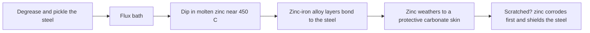

Steel wants to be rust. Add water and oxygen and iron oxidises; add salt from sea air or a splash pool and it happens faster. Corrosion control is therefore designed in. The workhorse is hot-dip galvanizing: cleaned steel is dipped in molten zinc at around 450 degrees Celsius, forming alloy layers bonded to the metal rather than sitting on it. ISO 1461 asks for at least 85 microns on thick sections.

Zinc protects twice. It is a barrier, weathering to a grey carbonate skin, and it is sacrificial: zinc is less noble than iron, so at a scratch the zinc corrodes first and the exposed steel stays whole until the zinc is used up. Paint adds colour and a second barrier, and the same galvanic logic warns against bolting dissimilar metals together in the wet.

Water rides are the hard case: flumes are built from fibreglass, concrete or galvanized steel because they live in spray. Coastal parks and [water parks](../masterplanning/water-parks.md) weigh this in [site selection](../masterplanning/site-selection.md), repainting cycles fill [maintenance programs](../safety-standards/maintenance-programs.md), scenic teams fake it all on purpose in [faux finishes and aging](../sensory-environment/faux-finishes-and-aging.md), and real corrosion quietly caps the [ride lifecycle](../operations-business/ride-lifecycle.md).

## Explore further
- `wikipedia-hot-dip-galvanization` — Hot-dip galvanization
- `galvanizeit-hdg-process` — Hot-Dip Galvanizing Process (American Galvanizers Association)
- `wikipedia-galvanic-corrosion` — Galvanic corrosion
