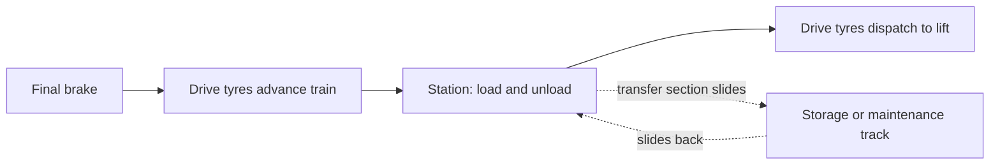

Brakes can stop a train, but something has to move it again at walking pace. That is the job of drive tyres: rubber wheels between the rails, spun by motors, which grip a flat fin under each car. They creep the train into the station, hold it at the gates, push it out toward the lift, and restart it after a hold on a flat block brake. They double as the kicker that finishes what a magnetic brake cannot.

A transfer track is a siding. A section of track slides sideways, or on some rides rotates, to line the circuit up with a storage or maintenance shed. On busy days every train runs; on quiet days one is parked, and mechanics can work on it without closing the ride. Many Bolliger & Mabillard coasters carry a train on the sliding piece itself, and Voltron Nevera links its station to the barn with a turntable.

Together they set the rhythm of [load and unload design](../operations-business/load-unload-design.md), let operators match [capacity to demand](../operations-business/capacity-vs-demand.md), underpin [maintenance programs](../safety-standards/maintenance-programs.md) and [availability](../operations-business/downtime-and-availability.md), and the slow glide into the station can even be staged as [load as story](../story-experience/load-as-story.md).

## Explore further
- `coasterpedia-transfer-track` — Transfer track (Coasterpedia)
- `coaster101-brakes-blocks-sensors` — Coasters-101: Brakes, Blocks, and Sensors
- `coaster101-terminology` — Coasters-101: Roller Coaster Terminology
