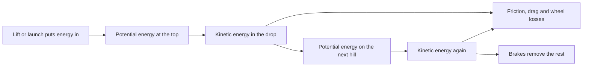

Almost every coaster is a gravity machine. A motor, chain, cable or magnet spends a minute hauling the train to a height, and from that moment the ride is a conversation between gravity and friction. Height becomes speed in the drop, speed becomes height on the next hill, and a little energy leaks away at every wheel and through the air until the brakes take what is left.

Thinking in energy answers the practical questions. How fast will the train be at the bottom? See [energy conversion](../ride-engineering/energy-conversion.md). Why does each hill have to be lower than the last? See [friction and drag](../ride-engineering/friction-and-drag.md). Why does the same ride run slower on a cold morning, and faster with a full load? See [train mass and weather](../ride-engineering/train-mass-and-weather.md). How does the energy get in? See [lift systems](../ride-engineering/lift-systems.md) and, for [launched coasters](../ride-systems/launched-coasters.md), the launch hardware. Putting all of it into a [speed profile](../ride-engineering/speed-profile.md) is how a layout is checked before steel is cut, and [water ride hydraulics](../ride-engineering/water-ride-hydraulics.md) shows the same budget with water doing the carrying.

## Explore further
- `pendrill-eager-jerk-snap-2020` — Velocity, acceleration, jerk, snap and vibration
- `coaster101-lift-hills` — Coasters-101: Roller Coaster Lift Hills
- `nolimits-2` — NoLimits 2 Roller Coaster Simulation
