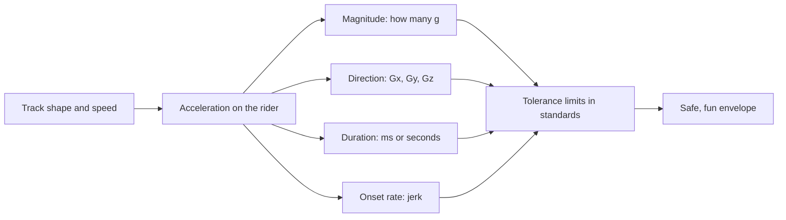

Every thrill on a ride is an acceleration, and every acceleration is a force pushing on a human body. This branch asks the engineering question behind the fun: how much can a person take, for how long, and from which direction? The answer is not a single number. A body tolerates a hard push into the seat far better than a pull out of it, a short jolt better than a long squeeze, and a gentle build-up better than a sudden snap.

Start with [g-force basics](../ride-engineering/g-force-basics.md), then see how [duration](../ride-engineering/g-tolerance-and-duration.md) and [jerk](../ride-engineering/jerk-and-onset-rate.md) change the picture. [Greyout and redout](../ride-engineering/greyout-and-redout.md) show what happens when limits are crossed. Standards such as [ASTM F2291](../safety-standards/astm-f2291.md) fold all of this into [acceleration envelopes](../ride-engineering/acceleration-envelopes.md) that a layout must stay inside, which is why the physiology here feeds straight into [ride layout design](../design-process/ride-layout-design.md).

## Explore further
- `wikipedia-g-force` — g-force
- `pendrill-eager-jerk-snap-2020` — Velocity, acceleration, jerk, snap and vibration
- `astm-f2291-design-practice` — ASTM F2291 Standard Practice for Design of Amusement Rides and Devices
