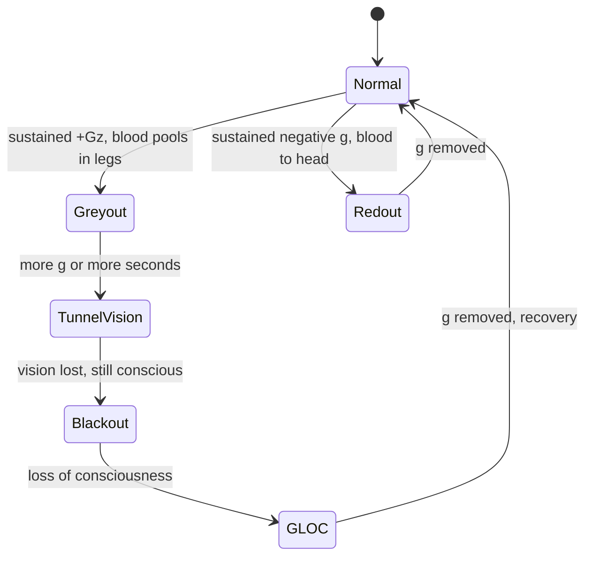

Greyout is the brain running short of oxygen for a moment. Under sustained positive g, blood drains toward the legs, blood pressure at the eyes falls, and the retina, which needs a steady supply, dims first. Colours wash out, the edges of vision close in, and if the load continues the sequence runs through tunnel vision and blackout to G-LOC, g-induced loss of consciousness. Pilots meet it in long turns; untrained people start to grey out somewhere around 4 to 5 g held for seconds.

Coasters rarely get that far because their peaks last under a few seconds, but long helices and the base of a loop are the usual places riders report a brief grey tunnel. The [clothoid loop](../ride-engineering/clothoid-loop.md) exists partly to shorten that peak. Spinning [inverting flat rides](../ride-systems/inverting-flats.md) can hold g longer than coasters do.

Redout is the mirror case: negative g pushes blood toward the head, the lower eyelid swells into view, and the world turns red. Tolerance is low, around 2 to 3 g, which is why rides keep negative g small and brief. Neither effect is [motion sickness](../human-factors/motion-sickness.md), which comes from sensory conflict rather than blood flow; both feed the warnings behind [medical exclusions](../human-factors/medical-exclusions.md).

## Explore further
- `wikipedia-greyout` — Greyout
- `wikipedia-g-force` — g-force
