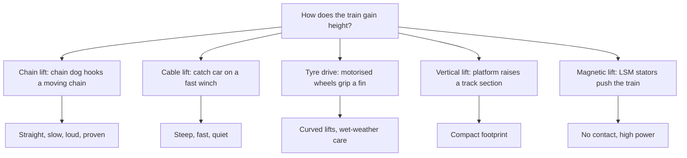

A lift hill is where the ride's energy is bought. The classic chain lift has barely changed in a century: a loop of chain runs in a trough between the rails, and a pivoting hook under the train, the chain dog, drops onto it. John Miller patented a chain dog in 1910. Chain lifts are straight, slow, loud and everywhere.

Cable lifts, introduced by Intamin on Millennium Force in 2000, pull a catch car up a channel with a cable; the lighter line allows a 45-degree climb at 15 miles per hour and far less noise. Tyre drives pinch a fin under the car between motorised wheels and can follow curves, which suits family coasters, though rain reduces grip. Vertical lifts raise a whole track section like an elevator, saving ground. Linear synchronous motors can push a train up a lift with no contact at all, as on Maverick at Cedar Point, blurring the line with a [launched coaster](../ride-systems/launched-coasters.md).

Whatever the type, the lift is usually its own block, must be able to stop with a train on it, and relies on [anti-rollback](../ride-engineering/anti-rollback.md) devices; the choice drives noise, capacity and the [coaster anatomy](../ride-systems/coaster-anatomy.md) of the whole ride.

## Explore further
- `coaster101-lift-hills` — Coasters-101: Roller Coaster Lift Hills
- `wikipedia-lift-hill` — Lift hill
- `wikipedia-millennium-force` — Millennium Force
