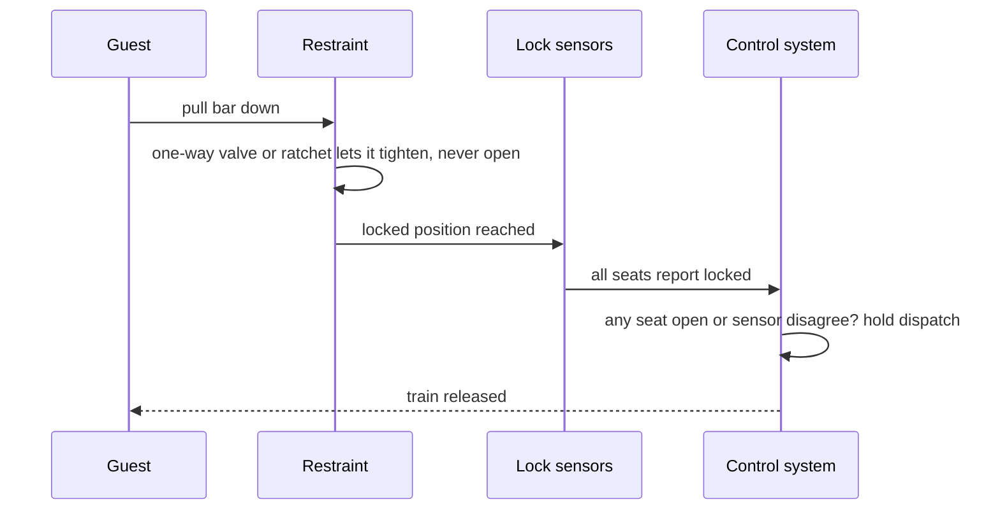

Closing a restraint is easy; the engineering is in making sure it cannot open until the station says so. Arrow's shoulder harnesses used a hydraulic cylinder with a one-way valve: an operator's foot pedal released it, and when locked the bar could move tighter but never looser. A ratchet does the same job mechanically on simpler rides.

Modern practice adds redundancy. Restraints are commonly described as having two independent locking arrangements, often a pair of hydraulic cylinders either of which can hold the bar alone, so one leak or stuck valve does not matter; exact architectures are not published in detail, so treat this as medium confidence. A sensor on each seat reports the bar's position, and the control system will not release the train while any restraint is open or any sensor disagrees with its partner. 

The remaining risk is human. A bar closed on a rider it does not fit is a [human factors incident](../safety-standards/human-factors-incidents.md), which is why [dispatch procedures](../safety-standards/dispatch-procedures.md) and [operator training](../safety-standards/operator-training.md) specify a push-pull check and daily [inspections](../safety-standards/inspections.md) test cylinders and sensors. The whole arrangement is a worked example of [redundancy and fail-safe](../safety-standards/redundancy-and-fail-safe.md) design.

## Explore further
- `coasterpedia-otsr` — Over-the-shoulder restraint (Coasterpedia)
- `wikipedia-roller-coaster-safety` — Roller coaster (mechanics and safety sections)
- `astm-f2291-design-practice` — ASTM F2291 Standard Practice for Design of Amusement Rides and Devices
