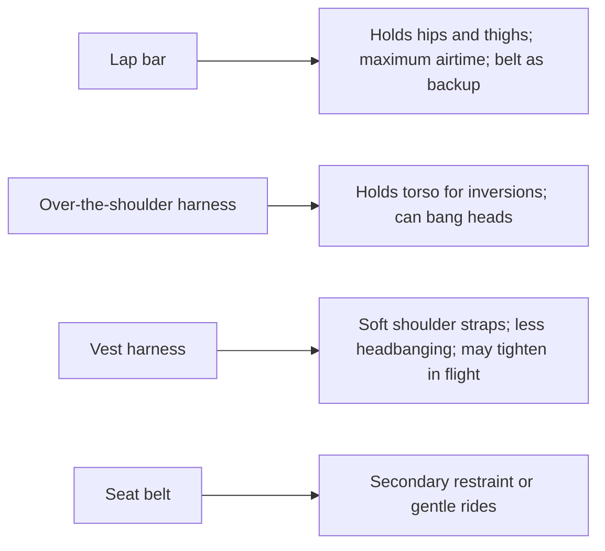

A restraint has one job and one constraint: keep every rider in the seat through every force the ride produces, without hurting them. The lap bar does this at the hips, where the body is strongest. It leaves the upper body free, which is why lap-bar rides deliver the best airtime, and a waist belt usually backs it up. 

Inversions brought the over-the-shoulder restraint, a padded U that swings down over the torso; Coasterpedia credits Arrow with introducing it on the 1975 Corkscrew. It feels secure, but on a rough ride the hard sides strike ears and temples. Bolliger & Mabillard's vest harness answers with soft shoulder straps, far gentler on the head, though it can cinch tighter in flight and blunt airtime. Belts alone serve gentle rides.

Rides change their minds. Six Flags Magic Mountain's Revolution gained shoulder harnesses in 1992 to stop riders standing and lost them in 2016 for lap and calf bars. Every choice must satisfy [restraint design rules](../safety-standards/restraint-design-rules.md), fit many bodies as [restraint fit](../human-factors/restraint-fit.md) describes, cap [airtime and negative g](../ride-engineering/airtime-and-negative-g.md), and shape the [risk perception and trust](../human-factors/risk-perception-and-trust.md) a nervous guest feels when the bar clicks down.

## Explore further
- `coasterpedia-otsr` — Over-the-shoulder restraint (Coasterpedia)
- `wikipedia-roller-coaster-safety` — Roller coaster (mechanics and safety sections)
- `wikipedia-great-american-revolution` — The New Revolution (roller coaster)
