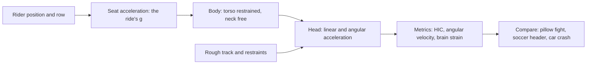

The g-force meter on the seat tells only half the story. A restrained torso stops with the car; the head, on the end of a flexible neck, does not. Rider biomechanics is the study of that difference: how seat accelerations become head motion, which metrics predict harm, and how position and track quality change the answer. It matters because the public debate about coaster safety, from congressional hearings in 2002 onward, was argued in g-force terms that researchers at Penn and Stanford have shown are the wrong units.

[Head and neck loads](../ride-engineering/head-and-neck-loads.md) covers the measurements and what they found, which is reassuring for the brain and more nuanced for the neck. [Rider position](../ride-engineering/rider-position.md) explains why the back row floats and the front row sees, and why two people in the same seat can record different head motion. [Rough rides](../ride-engineering/rough-rides.md) looks at the everyday case: lateral jolts and hard restraints that bruise rather than injure.

This branch complements [g-tolerance and duration](../ride-engineering/g-tolerance-and-duration.md), feeds the biomechanical judgement behind [ASTM F2291](../safety-standards/astm-f2291.md), and explains the wording of [medical exclusions](../human-factors/medical-exclusions.md) and the [age differences](../human-factors/age-differences.md) in who should ride.

## Explore further
- `smith-meaney-g-forces-brain-2002` — Roller Coasters, G Forces, and Brain Trauma: On the Wrong Track?
- `pfister-head-motions-2009` — Head Motions While Riding Roller Coasters: Implications for Brain Injury
- `ubc-fib-head-injury-coasters` — Injury Biomechanics of the Head with Relation to Roller Coasters
