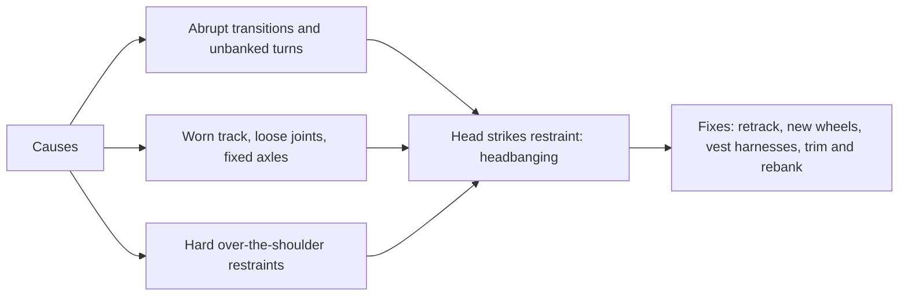

A ride is called rough when forces arrive as jolts rather than curves. The usual cause is lateral: a transition that changes curvature too quickly, a turn banked for the wrong speed, or a joint the wheels slap. The sideways snap throws the head against whatever is beside it, and if that is the hard shell of an over-the-shoulder harness the result is headbanging, the classic complaint about 1980s and 1990s looping coasters. Lap-bar rides can be as rough, but the jolt lands in the neck instead.

Age adds to it. Wooden track wears and loosens, older trains with fixed axles shuffle through curves, and worn wheels and bearings change the ride season by season. Great Coasters International retracked Knott's GhostRider in 2016, and Rocky Mountain Construction built a business converting rough woodies to steel I-Box track from 2011. Bolliger & Mabillard's soft vest harnesses tamed the restraint side.

Roughness is a maintenance signal as much as a design flaw, so it belongs in [preventive maintenance](../operations-business/preventive-maintenance.md) and sometimes triggers [retheming and overlays](../operations-business/retheming-and-overlays.md) or a full rebuild in the [RMC hybrid era](../history/rmc-hybrid-era.md). Some [sensation seekers](../human-factors/sensation-seeking.md) prize a wild woodie; most guests leave with a headache and a [guest recovery](../operations-business/guest-recovery.md) conversation.

## Explore further
- `coasterpedia-otsr` — Over-the-shoulder restraint (Coasterpedia)
- `wikipedia-great-coasters-international` — Great Coasters International
- `wikipedia-rocky-mountain-construction` — Rocky Mountain Construction
