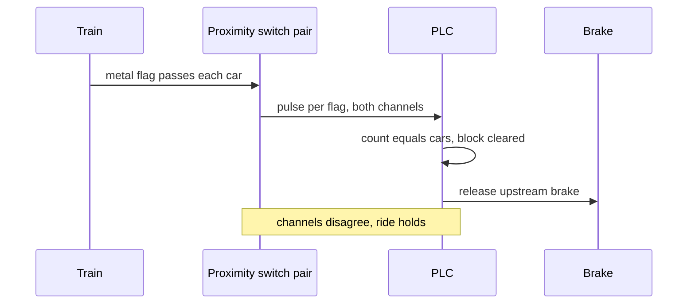

A ride controller cannot see; it counts. The workhorse is the inductive proximity switch, a coil driven as a tuned oscillator whose field is damped when metal comes near. Each car carries a steel flag, and as the train passes a switch the controller gets one pulse per car. Count the right number and the train has cleared the block; count too few and the ride holds. Switches are sealed and have no moving parts, which is why Coaster101 calls them the most popular choice. They are installed in parallel pairs so one failure cannot produce a false clear, and a pair at a known spacing also gives speed, which a trim brake upstream may use to decide how hard to bite.

Photo-electric eyes serve where flags are impractical, though a dropped hat can break the beam. Spring-armed limit switches are an older option. In the station, sensors on every restraint confirm it is locked before dispatch is allowed.

The same pulses feed [ride show synchronisation](../show-technology/ride-show-synchronization.md), triggering effects as cars pass, and their safety role is graded through [safety integrity levels](../safety-standards/safety-integrity-levels.md). Newer [vision-based monitoring](../ai-future/vision-safety-monitoring.md) adds cameras, but the counted flag remains the backbone of the [block system](../ride-engineering/block-system.md).

## Explore further
- `coaster101-brakes-blocks-sensors` — Coasters-101: Brakes, Blocks, and Sensors
- `wikipedia-inductive-sensor` — Inductive sensor
- `wikipedia-trim-brake` — Trim brake
