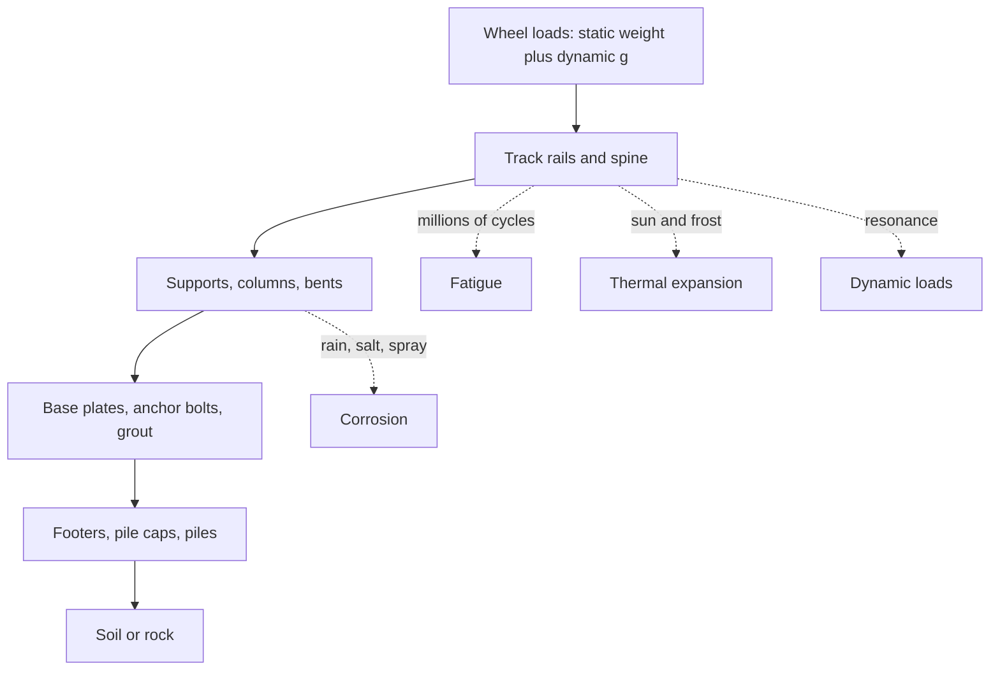

A ride is a bridge that is hit by a train every ninety seconds, all day, for decades. The structural branch asks what carries those loads and what slowly gives way. [Supports and foundations](../ride-engineering/supports-and-foundations.md) trace the path from wheel to soil. [Fatigue](../ride-engineering/fatigue.md) is the quiet enemy: stresses far below yield that, repeated millions of times, grow cracks from welds and bolt holes, which is why Stengel's firm lists fatigue analysis as a core service. [Dynamic loads](../ride-engineering/dynamic-loads.md) cover vibration and resonance, the reason a structure must be stiffer, or better damped, than static sums suggest.

Material choices run through all of it. [Wood versus steel](../ride-engineering/wood-vs-steel.md) compares a flexing laminate that needs yearly replacement with a rigid section that must be protected from rust, and [corrosion and weathering](../ride-engineering/corrosion-and-weathering.md) and [thermal expansion](../ride-engineering/thermal-expansion.md) describe how sun, salt and seasons work on both. These cards connect outward to [site construction](../design-process/site-construction.md), to the manufacturing quality rules of [ASTM F1193](../safety-standards/astm-f1193.md), and to the [ride lifecycle](../operations-business/ride-lifecycle.md) that ends in retracking, rebuilding or removal.

## Explore further
- `coaster101-foundations` — Coasters-101: Foundations
- `stengel-engineering-about` — IB Stengel GmbH: About us
- `wikipedia-fatigue-material` — Fatigue (material)
