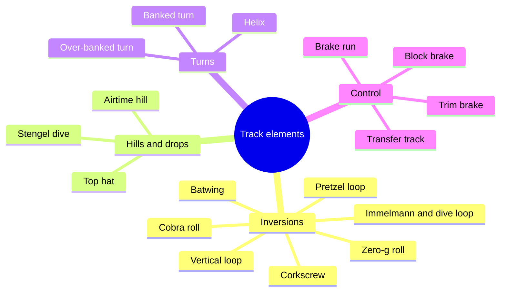

Elements are the words of a coaster layout. The inversion family covers everything that turns riders upside down: the vertical loop, the corkscrew, the Immelmann (half loop into half roll) and its reverse, the dive loop; the zero-g roll; the cobra roll and batwing; the pretzel loop of flying coasters. Hills and drops include the camelback airtime hill, the top hat of launched rides, and the Stengel dive, a banked hill crest that Werner Stengel designed for Goliath at Walibi Holland in 2002. Turns and helices, and the control elements of brake runs, block brakes, trims and transfer tracks, complete the set.

Many names mark a first. Arrow Dynamics' Corkscrew at Knott's Berry Farm, opened 21 May 1975, was the first modern inverting coaster; Vekoma's cobra roll debuted on Sea Serpent at Morey's Piers in 1984; the batwing began as Arrow's Kamikaze Kurve on Orient Express in 1980.

Designers do not pick elements at random. The sequence is written against a [ride beat sheet](../story-experience/ride-beat-sheet.md) so that [tension and release](../story-experience/tension-and-release.md) builds, and each piece must still fit the [coaster anatomy](../ride-systems/coaster-anatomy.md) of lift, drop and brake. The [dive coaster](../ride-systems/dive-coasters.md) shows how one signature element can define a whole model.

## Explore further
- `wikipedia-roller-coaster-elements` — List of roller coaster elements
- `wikipedia-corkscrew-silverwood` — Corkscrew (Silverwood), formerly Knott's Berry Farm
- `coaster101-terminology` — Coasters-101: Roller Coaster Terminology
