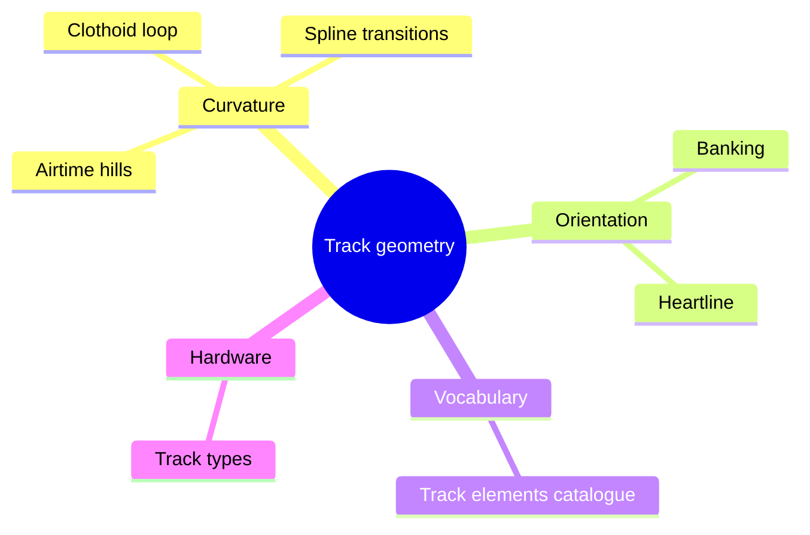

A coaster track is a line through space, and everything the rider feels comes from how that line bends and rolls. Curvature decides the size of the force; the rate of change of curvature decides how abruptly it arrives; bank and roll decide which way it points. Track geometry is the discipline of controlling all three at once, so that the forces on the rider stay inside the [acceleration envelopes](../ride-engineering/acceleration-envelopes.md) while still delivering the drama.

Two ideas from Werner Stengel underpin modern practice. The [clothoid loop](../ride-engineering/clothoid-loop.md) replaces the circle with a curve whose radius changes gradually, and [heartline](../ride-engineering/heartline.md) design rolls the track about the rider's chest rather than the rail centre. [Banking](../ride-engineering/banking.md) and [spline transitions](../ride-engineering/spline-transitions.md) apply the same thinking to turns, while [airtime hills](../ride-engineering/airtime-hills.md) show how a vertical curve becomes a feeling. The [track elements catalogue](../ride-engineering/track-elements.md) names the results and [track types](../ride-engineering/track-types.md) describe the steel and wood that carry them. All of this becomes concrete in [ride layout design](../design-process/ride-layout-design.md).

## Explore further
- `liseberg-stengel-coasters` — Werner Stengel and the Liseberg roller coasters
- `wikipedia-euler-spiral` — Euler spiral
- `nolimits-2` — NoLimits 2 Roller Coaster Simulation
