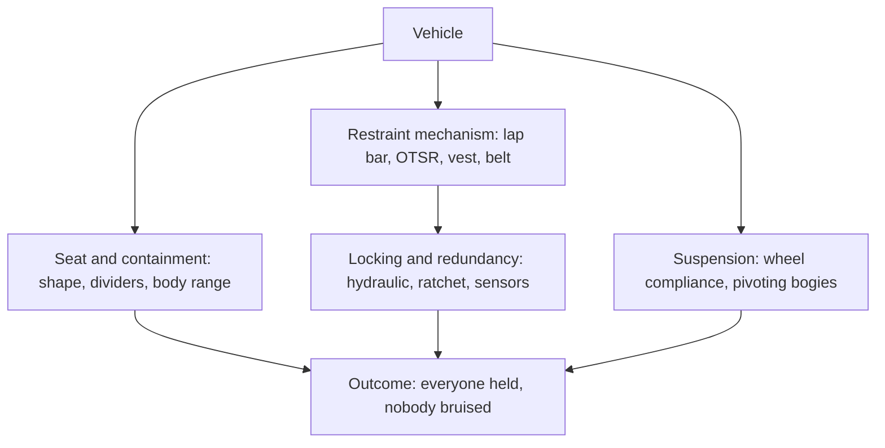

Track and structure are invisible to most guests; the vehicle is what they climb into, grip, and judge the ride by. This branch covers the engineering of that object. [Restraint mechanisms](../ride-engineering/restraint-mechanisms.md) compares lap bars, over-the-shoulder harnesses, vests and belts, each a different bargain between freedom and security. [Restraint locking](../ride-engineering/restraint-locking.md) explains how a bar stays shut when it must, with redundant cylinders and sensors that stop a dispatch if anything is open. [Seat and containment](../ride-engineering/seat-and-containment.md) looks at the seat itself: the shape that keeps a small child and a large adult equally inside under negative g. [Vehicle suspension](../ride-engineering/vehicle-suspension.md) is the less obvious part, the compliance in wheels and bogies that turns track imperfections into a smooth ride or a rough one.

All four sit under the restraint and containment criteria of [ASTM F2291](../safety-standards/astm-f2291.md) and the broader [restraint design rules](../safety-standards/restraint-design-rules.md), and they meet human bodies through [restraint fit](../human-factors/restraint-fit.md) and the demands of [accessible vehicles](../human-factors/accessible-vehicles.md). Hang the seat below the rail and the same engineering gives you an [inverted coaster](../ride-systems/inverted-coasters.md).

## Explore further
- `coasterpedia-otsr` — Over-the-shoulder restraint (Coasterpedia)
- `astm-f2291-design-practice` — ASTM F2291 Standard Practice for Design of Amusement Rides and Devices
- `coaster101-wheel-design` — Coasters-101: Roller Coaster Wheel Design
