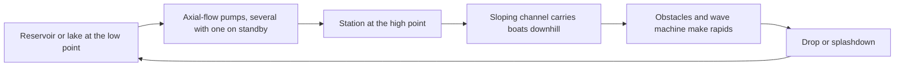

A water ride is a coaster whose train is a boat and whose lift is a pump. In a river rapids ride the station sits at the highest point and the channel slopes gently back down; axial-flow submersible pumps, often four with one spare, lift water from the lake at the bottom so it can flow again. Switch them off and the water drains back; refilling an empty channel can take a quarter of an hour. Rapids are manufactured: tubes on the channel floor break the flow, and wave machines, rocks and jets add turbulence.

Log flumes work the same way with a narrower trough. Water carries the log between a chain lift and the final drop, and the size of the splash is tuned with rubber belting on the run-out. Arrow's El Aserradero of 1963 established the form. [Water coasters](../ride-systems/water-coaster.md) hybridise further, running boats on dry track and dropping them into water sections.

The pump room is serious [utilities and central plant](../masterplanning/utilities-and-central-plant.md), with flow, treatment and evaporation scaling with the ride. The same hydraulics drive scenic [water features](../sensory-environment/water-features.md), and buoyancy, not wheels, sets how a [log flume](../ride-systems/log-flume.md) or [river rapids](../ride-systems/river-rapids.md) boat behaves when loads change.

## Explore further
- `wikipedia-river-rapids-ride` — River rapids ride
- `wikipedia-log-flume` — Log flume (ride)
- `intamin-water-coaster` — Intamin Water Coaster
