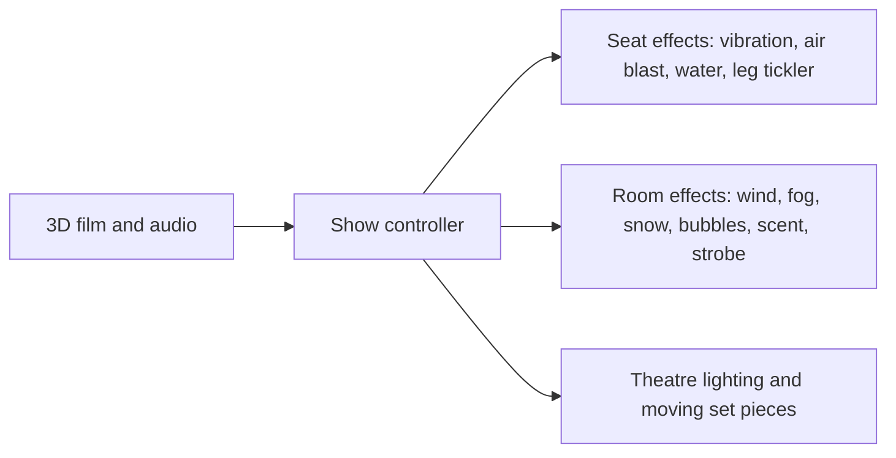

A 4D theatre is a cinema with a show controller. The audience wears 3D glasses ([stereoscopic 3D](../show-technology/stereoscopic-3d.md)), and every cue in the film triggers something physical: seats vibrate or tip, nozzles spit mist or blast air at the neck, a "leg tickler" brushes ankles, fans, fog, snow, bubbles and scent fill the room ([wind, heat and scent effects](../show-technology/wind-heat-and-scent-effects.md)). The Sensorium at Six Flags Power Plant (1984) is regarded as the first; Disney's Captain EO (1986), Muppet*Vision 3D (1991) and Honey, I Shrunk the Audience (1994) made the form a park staple, often with animatronics and set pieces around the screen for a live-theatre feel ([theatre staging](../story-experience/theatre-staging.md)).

Vendors such as Simworx sell the whole package, projectors, grandstand seating with one- or three-axis motion and a film library, so a regional park or museum can open one in a season. Hundreds of seats per show and a cycle of fifteen minutes make it an efficient answer to [capacity versus demand](../operations-business/capacity-vs-demand.md).

**Walkthroughs** are the ride-less cousins: haunted houses, exhibition-style queues and [story rooms](../story-experience/story-rooms-and-walkthroughs.md) where guests move at their own pace through sets, effects and performers. They share the theatre's cheapness and its dependence on good cueing rather than hardware.

## Explore further
- `wikipedia-4d-film` — 4D film (Wikipedia)
- `simworx-4d-cinema` — Simworx 4D Cinema
- `simworx-products` — Simworx attractions catalogue
