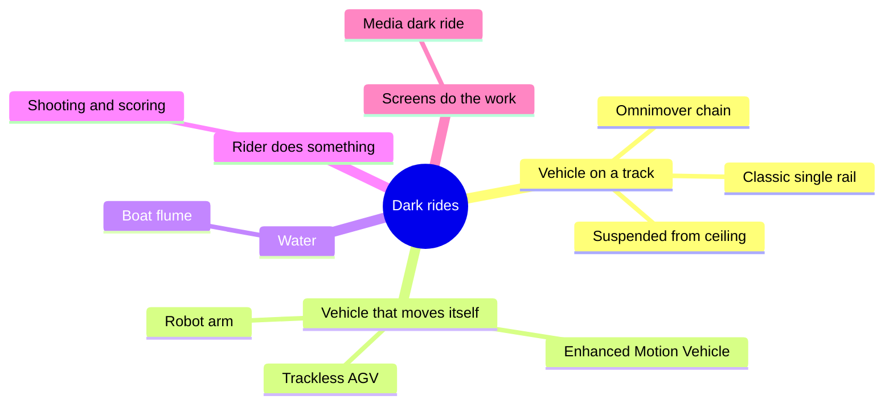

A dark ride is an enclosed attraction where a vehicle carries you through a sequence of scenes you could not walk through. The name is literal: the building is kept dark so that lighting, projection and [animatronics](../show-technology/animatronics.md) control exactly what you see and when ([dark adaptation](../human-factors/dark-adaptation.md)). Where a coaster sells force, a dark ride sells narrative, which makes it the main vehicle of [story-driven design](../story-experience/story-driven-design.md).

The lineage runs from 1900s Old Mill boat tunnels and 1928 Pretzel cars to Disneyland's 1955 Fantasyland rides, then to the [Haunted Mansion](../history/haunted-mansion.md) and its Omnimover in 1969. Since the 1990s the vehicle itself has become a show device: motion bases on a chassis, trackless robots that wander, and robot arms that fly riders into screens.

The cards below sort the family by what the vehicle does. Tracked systems (classic, Omnimover, suspended) trade freedom for capacity and reliability. Self-moving systems (EMV, trackless, robot arm) buy freedom with complexity. Boats, shooting rides and media rides are defined by their medium rather than their track. Whatever the type, every scene is timed by a [show control system](../show-technology/show-control-systems.md) that treats each vehicle as a cue.

## Explore further
- `wikipedia-dark-ride` — Dark ride (Wikipedia)
- `wikipedia-pretzel-amusement-ride-company` — Pretzel Amusement Ride Company (Wikipedia)
- `wikipedia-omnimover` — Omnimover (Wikipedia)
