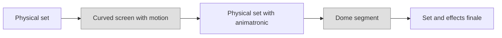

Pure simulators keep riders in one place; pure dark rides keep them among built things. Hybrids move riders through both, cutting from a real corridor to a curved screen and back so the screen's edges are never seen. The trick is geometry: a screen has to fill the rider's field of view at the moment they reach it, which means domes, parabolic sections, and tracks or arms that aim the seat precisely at the centre of the picture.

Harry Potter and the Forbidden Journey (2010) is the clearest example. Its robot-arm benches pass through sets and animatronics, then are dipped into dome segments mounted on turntables that rotate to stay in front of the riders, before returning to physical scenes ([Forbidden Journey](../history/forbidden-journey.md)). Avatar Flight of Passage (2017) runs the other way: a flying-theatre format where the "link chair" seats face a 3D screen, with animatronic elements folded in ([Flight of Passage](../history/flight-of-passage.md)).

Technically these rides lean on [projector blending](../show-technology/projector-blending.md) across many overlapping projectors and on [media servers](../show-technology/media-servers-and-real-time-engines.md) locked to vehicle position. Creatively they are the practical answer to the [screens vs sets debate](../show-technology/screens-vs-sets-debate.md): use each where it is strongest and hide the seam.

## Explore further
- `wikipedia-flight-of-passage` — Avatar Flight of Passage (Wikipedia)
- `wikipedia-forbidden-journey` — Harry Potter and the Forbidden Journey (Wikipedia)
- `wikipedia-flying-theater` — Flying theater (Wikipedia)
