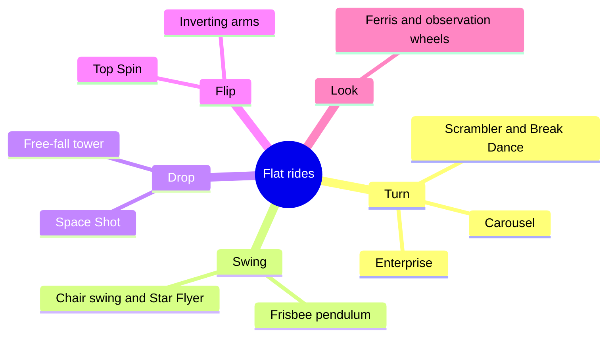

Flat rides are everything that is not a coaster, a dark ride or a water ride: machines that stay put and move the riders. The name comes from the travelling fair, where a ride had to fold onto a trailer and stand on a flat pitch. Most are sold from catalogues by HUSS, Zamperla, Mondial, Funtime, Zierer and others, with fixed cycles, known capacity and a price a regional park can afford, which makes them the filler of every [attraction mix](../masterplanning/attraction-mix.md).

They are sorted by motion. **Turning** rides spin riders in circles, from the carousel to the Scrambler. **Swinging** rides hang gondolas from arms or cables. **Drop** rides raise and release. **Flipping** rides invert riders on arms. **Observation** rides lift people slowly for the view. Many combine two, which is where the strongest [vestibular](../human-factors/vestibular-system.md) effects, and the strongest reactions, come from.

Because flat rides come as products, they are the place the standards bite hardest: [EN 13814](../safety-standards/en-13814.md) and its ASTM cousins set the envelope for restraints and [g-forces](../ride-engineering/g-force-basics.md). The lineage runs back through the [trolley parks](../history/trolley-parks.md) and fairs where these machines were born.

## Explore further
- `huss-rides` — HUSS Park Attractions product range
- `zamperla-flat-rides` — Zamperla flat rides
- `wikipedia-frisbee-ride` — Frisbee ride (Wikipedia)
