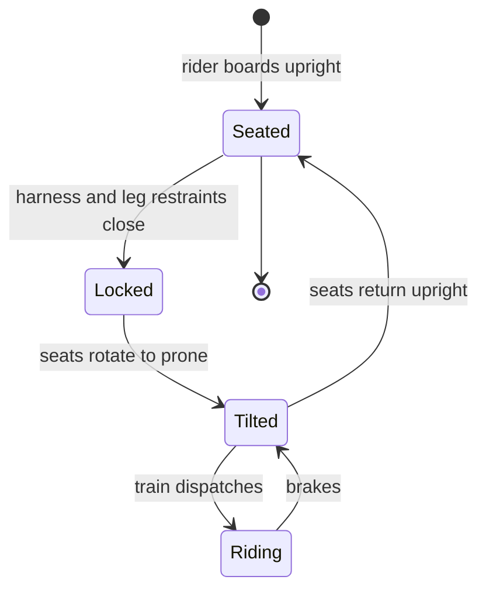

A flying coaster carries riders face down, belly to the ground, suspended below the track. The posture is the whole point: with arms out and nothing in front, the body reads the ride as flight rather than as sitting in a vehicle, a strong cue for [vection](../human-factors/vection.md), the illusion of self-motion.

Getting people into that posture is the engineering challenge. Vekoma's Flying Dutchman (Stealth, 2000) loads riders seated, then reclines the seats on their backs and flips the train prone in the track's first twist. B&M's design, first on Air at Alton Towers in 2002, loads riders seated under the track like an inverted coaster, then tilts the whole seat row forward to lie flat. Every version needs a full-body [restraint](../ride-engineering/restraint-mechanisms.md) with leg clamps, since the rider hangs from it, and a tilt cycle that lengthens every dispatch ([load and unload design](../operations-business/load-unload-design.md)).

Layouts exploit the [rider position](../ride-engineering/rider-position.md): a "pretzel loop" dives riders onto their backs for heavy positive g, while gentle rolls give the swooping feel of a glider. Manta at SeaWorld Orlando and F.L.Y. at Phantasialand, a launched Vekoma version, are current benchmarks; Zamperla's Volare is the compact family-park variant.

## Explore further
- `wikipedia-flying-roller-coaster` — Flying roller coaster (Wikipedia)
- `zamperla-roller-coasters` — Zamperla roller coaster range
- `rcdb-home` — Roller Coaster DataBase
