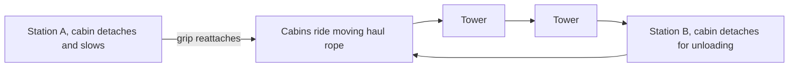

A gondola or skyride is a ski lift in a theme park. Small cabins hang from a continuously moving steel rope; at each station a detachable grip lets the cabin slow to walking pace for loading and then re-clamps for the trip. Disney's Skyway, a Von Roll detachable monocable lift opened at Disneyland in 1956, flew four-seat buckets between Fantasyland and Tomorrowland. Copies ran at Magic Kingdom and Tokyo Disneyland; all closed by 1999.

The ride's gift is a view no path can offer ([sightlines](../story-experience/sightlines.md)), and its trap is the same thing: cabins overfly rooftops, service yards and the seams between lands, so designers must either hide backstage from above or route the line to make the flight itself a [land transition](../masterplanning/land-transitions.md). Ropeways are shut by wind and lightning before most rides ([weather policies](../safety-standards/weather-policies.md)), and a stall leaves people in the air, so [evacuation](../safety-standards/emergency-stop-and-evacuation.md) planning is a defining constraint.

The technology is mature and comes from outside the industry, a classic [borrowed craft](../story-experience/borrowed-crafts.md): Doppelmayr Garaventa, formed in 2002 from the Austrian and Swiss leaders, builds gondolas, 3S tricable lifts and urban cable cars worldwide, and parks increasingly buy from the same catalogue as mountains do.

## Explore further
- `wikipedia-skyway-disney` — Skyway (Disney) (Wikipedia)
- `wikipedia-doppelmayr-garaventa` — Doppelmayr Garaventa Group (Wikipedia)
