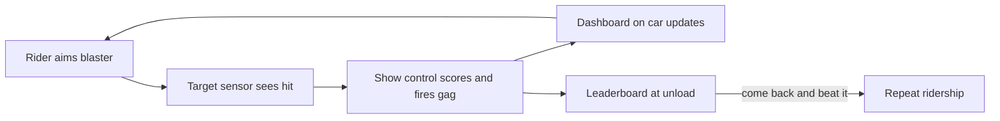

An interactive dark ride gives riders something to do. Most commonly each seat has a blaster; targets in the scenes carry infrared sensors, a hit triggers a light, a sound or a moving gag, and a running score shows on the car. The ride becomes a game with a result, and Sally Dark Rides says scoring is their best tool for repeat ridership. The first shooting dark ride is usually credited to El Paso at Bobbejaanland in Belgium in 1984, with Sally's Ghost Blasters and Disney's Buzz Lightyear's Space Ranger Spin (1998) making the format mainstream.

Buzz Lightyear shows the engineering. It runs on an Omnimover chain, but each pod has a joystick that spins it 360 degrees so riders can aim, and targets are worth 100 to 10,000 points depending on difficulty, with a seven-level ranking at the end.

Design-wise this is [interactive narrative](../story-experience/interactive-narrative.md) at its simplest, trading some spectacle for [agency](../human-factors/agency-vs-spectacle.md) and tapping [play](../human-factors/play-and-exploration.md). The [show control system](../show-technology/show-control-systems.md) must track every shot per seat, which is more data than a conventional ride ever produces. [Spider-Man and Transformers](../history/spider-man-and-transformers.md) show the screen-heavy end of the spectrum.

## Explore further
- `sally-dark-rides` — Sally Dark Rides
- `wikipedia-buzz-lightyear-space-ranger-spin` — Buzz Lightyear's Space Ranger Spin (Wikipedia)
- `wikipedia-dark-ride` — Dark ride (Wikipedia)
