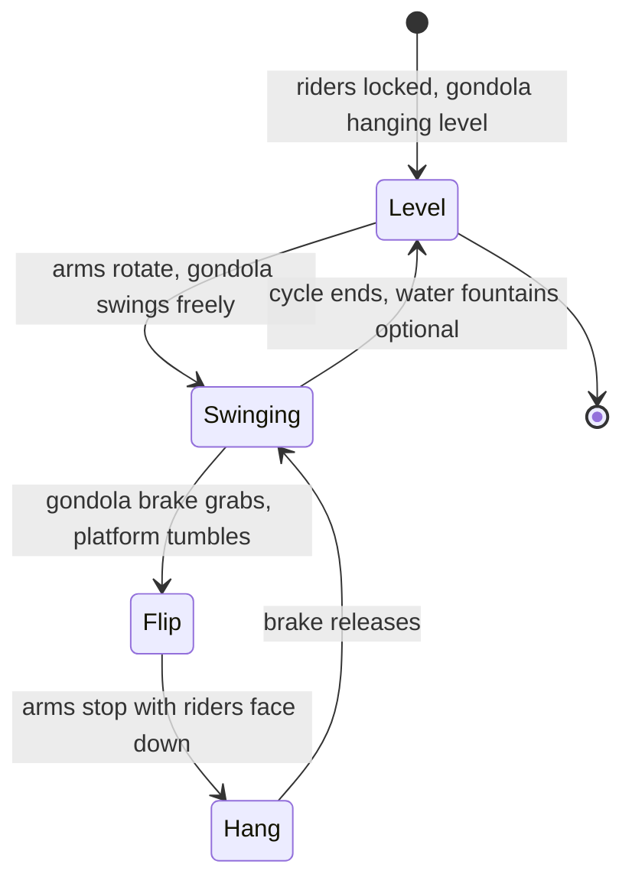

Inverting flats turn riders upside down without a track. The best known is HUSS's **Top Spin** (1990): a theatre-style platform of 40 riders hangs between two counterweighted arms. Motors turn the arms; the platform is free to swing, and a brake on its pivot grabs and releases at programmed moments so the platform tumbles, stops face-down for a long hang, then tumbles again. Operators pick from preset programs of a minute or two. Zamperla's Windshear, Mondial's Super Nova and others copy the principle, some with arms that move independently for diagonal flips.

The older **Enterprise** inverts by a different route: gondolas on a spinning wheel that is tilted upright, so riders loop at the top with no shoulder bar, held in by centrifugal force alone.

Hanging upside down for seconds at a time is what makes this family demanding. Blood pools toward the head during inverted hang time, so cycle design respects [g-tolerance and duration](../ride-engineering/g-tolerance-and-duration.md) limits and the warning signs of [grey-out and red-out](../ride-engineering/greyout-and-redout.md). Restraints must be proven locked before the arms move ([restraint locking](../ride-engineering/restraint-locking.md)) and [operator training](../safety-standards/operator-training.md) covers manual cycles. Choreographing the brake grabs is close kin to [figure programming](../show-technology/figure-programming.md).

## Explore further
- `wikipedia-top-spin-ride` — Top Spin ride (Wikipedia)
- `huss-top-spin-classic` — HUSS Top Spin Classic
- `huss-rides` — HUSS Park Attractions
