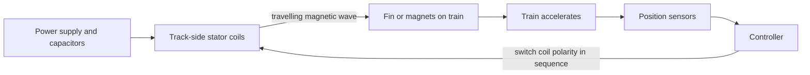

Linear motors are ordinary electric motors unrolled flat. Coils bolted beside the track are switched on in sequence, making a magnetic wave that travels down the launch section. Something on the train rides that wave, and the train is dragged along with it. Nothing touches and the push can be shaped by software.

The two kinds differ in what is on the train. A **linear induction motor** (LIM) uses a plain aluminium or copper fin: the moving field induces currents in it, and those currents are pushed. A **linear synchronous motor** (LSM) bolts rare-earth permanent magnets to the train and the coils pull and push them directly. LSM is more efficient and gives a stronger, better-controlled shove, so most modern launches are LSM. The same hardware run in reverse is a brake ([brake types](../ride-engineering/brake-types.md)).

Premier Rides' Flight of Fear, opened in 1996 at Kings Island and Kings Dominion, was the first LIM coaster and opened the [launch era](../history/launch-era.md). The engineering catch is the air gap: Universal's patent US 10,377,400 is about keeping fin and coils millimetres apart through curves. Because launches can run forward and backward, LSM made the [multi-launch coaster](../ride-systems/multi-launch-coasters.md) possible, under tight [ride control](../safety-standards/ride-control-systems.md).

## Explore further
- `coaster101-launch-systems` — Coasters-101: Launch Systems
- `google-patents-us-10377400` — US 10,377,400 braking or launching a ride vehicle
- `wikipedia-flight-of-fear` — Flight of Fear (Wikipedia)
- `intamin-lsm-launch-coaster` — Intamin LSM Launch Coaster
