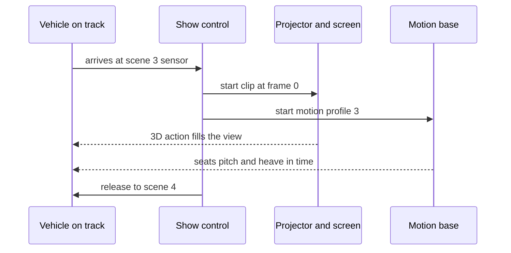

A screen-based dark ride replaces most of the built scenery with projected film. The vehicle carries a motion base, so when the screen shows a fall the seats drop and when it shows a punch the cabin jolts, and the two are locked together by [ride-show synchronisation](../show-technology/ride-show-synchronization.md). Screens are usually curved and stereoscopic so the image has depth around the vehicle ([stereoscopic 3D](../show-technology/stereoscopic-3d.md)), with physical set pieces, wind, heat and water bridging the gap between film and room.

Universal's The Amazing Adventures of Spider-Man at Islands of Adventure (1999) is the reference design. Its twelve-seat "SCOOP" vehicles, co-developed with Oceaneering, have a six-degree-of-freedom motion base and can yaw a full 360 degrees; Universal's 1998 patent (US 6,095,926) describes exactly this layout of six actuators on a tracked chassis. Thirteen 30-foot screens, twelve of them 3D, do the storytelling. Transformers reuses the system.

The format makes [IP adaptation](../story-experience/ip-adaptation.md) fast, since filmed characters need no animatronic double, but it is also the centre of the [screens vs sets debate](../show-technology/screens-vs-sets-debate.md): media can be refreshed cheaply, yet it can feel flat without physical anchors. The seat's job is explained in [motion base](../ride-systems/motion-base.md); the history is in [Spider-Man and Transformers](../history/spider-man-and-transformers.md).

## Explore further
- `wikipedia-amazing-adventures-of-spider-man` — The Amazing Adventures of Spider-Man (Wikipedia)
- `google-patents-us-6095926` — US 6,095,926 Amusement ride vehicle
- `wikipedia-dark-ride` — Dark ride (Wikipedia)
