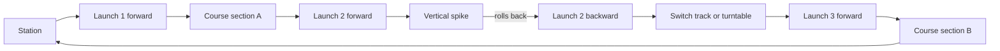

A multi-launch coaster uses electromagnetic launches more than once, and often in both directions. Because an [LSM](../ride-systems/lsm-lim-launch.md) section can accelerate a train whichever way it is travelling, a layout can throw the train up a dead-end spike, let it roll back through the same launch, catch it, and fire it off somewhere new. Switch tracks and turntables move the train onto another path mid-ride. The train's energy no longer peaks once at the top of a lift; it is topped up wherever the designer wants a new act.

That makes these rides natural storytellers. Each launch is a fresh beat, which maps directly onto a [ride beat sheet](../story-experience/ride-beat-sheet.md): a slow themed lead-in, a surprise launch, a false ending on a spike, a bigger launch for the finale ([tension and release](../story-experience/tension-and-release.md)). Intamin's Taron at Phantasialand (2016), Mack's Stryker-based Voltron Nevera at Europa-Park and Gerstlauer's Infinity Coasters with "pendulum" launches are the reference examples.

The cost is control complexity. Several trains, launches that can run backward and track switches mean a far more elaborate [block system](../ride-engineering/block-system.md), with [switch tracks](../ride-engineering/drive-tires-and-transfer-tracks.md) and launch zones all interlocked in the [ride control system](../safety-standards/ride-control-systems.md) so no two trains can ever meet.

## Explore further
- `mack-rides-stryker` — Mack Rides Stryker coaster system
- `gerstlauer-infinity-coaster` — Gerstlauer Infinity Coaster
- `intamin-lsm-launch-coaster` — Intamin LSM Launch Coaster
