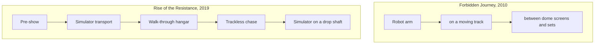

A multi-system attraction strings several ride technologies into one story, so each scene uses whichever system sells it best. The new thing is the combination rather than any single machine, which Wendover Productions calls "innovative amalgamation".

[Forbidden Journey](../history/forbidden-journey.md) (2010) puts a KUKA arm on a moving track and swings riders between dome screens and physical sets; see [robot-arm ride](../ride-systems/robot-arm-ride.md). [Rise of the Resistance](../history/rise-of-the-resistance.md) (2019) goes further: a pre-show, a transport that is a motion simulator, a walk through a hangar, a [trackless](../ride-systems/trackless-ride.md) chase, and an escape pod that is a simulator on a drop shaft.

The gains are pacing and surprise: riders cannot read the next scene from a visible track, and each act can change scale. The costs are integration and reliability. Every hand-off between systems is a timing problem for [show control](../show-technology/show-control-systems.md), and each added system is another way for the whole attraction to stop, which shows in [downtime and availability](../operations-business/downtime-and-availability.md).

## Explore further
- `wikipedia-forbidden-journey` — Harry Potter and the Forbidden Journey
- `wikipedia-rise-of-the-resistance` — Star Wars: Rise of the Resistance
- `wendover-how-to-design-a-theme-park` — How to Design a Theme Park (To Take Tons of Your Money)
