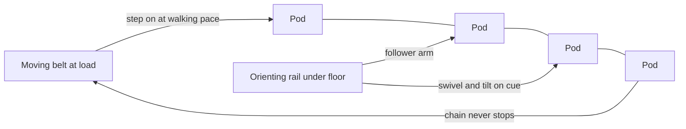

An Omnimover is a train of clam-shell pods linked into one endless chain that never stops. Guests board from a conveyor belt moving at the same slow pace, about 0.6 metres a second, so there is no dispatch and no gap between groups: capacity is set by chain speed alone, which is why Haunted Mansion-style rides move thousands of people an hour with almost no operator effort ([throughput math](../operations-business/throughput-math.md), [load and unload design](../operations-business/load-unload-design.md)).

The clever part is under the floor. Each pod carries a follower arm riding on contoured **orienting rails**; as the rails curve, the pod swivels a full 360 degrees and tilts to stay level on slopes. Designers therefore decide where every rider is looking at every second. Walt Disney Imagineering's Roger Broggie and Bert Brundage filed the patent (US 3,554,130) in 1968 and Bob Gurr named it; the first was Adventure Thru Inner Space in 1967, and the [Haunted Mansion](../history/haunted-mansion.md) "Doom Buggies" followed in 1969.

That gaze control is cinema's grammar brought to a vehicle: a pan, a reveal, a cut-away from the trick you must not see ([cinematic grammar](../story-experience/cinematic-grammar.md), [visual attention](../human-factors/visual-attention.md)). The system grew from the PeopleMover built for Ford at the [1964 World's Fair](../history/worlds-fair-1964.md).

## Explore further
- `wikipedia-omnimover` — Omnimover (Wikipedia)
- `google-patents-us-3554130` — US 3,554,130 Amusement ride system
- `wikipedia-adventure-thru-inner-space` — Adventure Thru Inner Space (Wikipedia)
