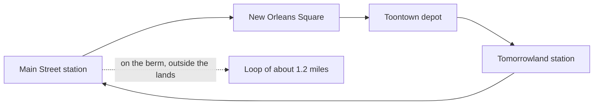

A park train is a real railway shrunk to park scale. The Disneyland Railroad, opened with the park on 17 July 1955, runs three-foot gauge steam locomotives, two built by WED and three historic Baldwins from 1894 to 1925, on a 1.2-mile loop with four stations; a round trip takes about twenty minutes and the line carries millions of riders a year. Walt Disney's own backyard railway inspired it, a founding myth of the park ([Walt and the Imagineers](../history/walt-and-the-imagineers.md)).

The loop does quiet planning work. It runs on top of [the berm](../story-experience/the-berm.md), the earth wall that hides the outside world, so riders get a panoramic tour without the lands ever seeing the train's backstage. Stations at opposite ends of the park let guests skip a long walk ([guest flow patterns](../masterplanning/guest-flow-patterns.md)), and the ride is a seated, shaded break that planners count among the [rest areas](../masterplanning/rest-areas.md).

Most parks cannot run live steam. Chance Rides' C.P. Huntington, a gas or electric locomotive styled on an 1863 original, is the stock answer, and hundreds circle zoos and regional parks. Whatever the power, the appeal is the same slow [nostalgia](../human-factors/nostalgia.md): a whistle, a bell and a view from a window.

## Explore further
- `wikipedia-disneyland-railroad` — Disneyland Railroad (Wikipedia)
- `chance-rides` — Chance Rides
