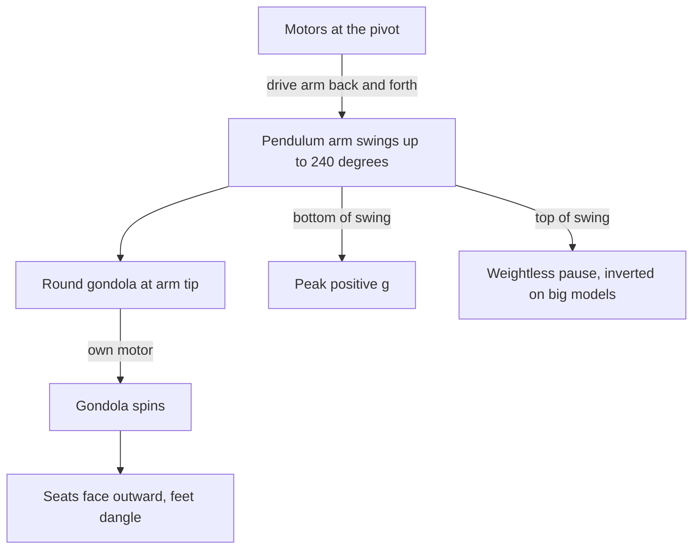

A pendulum ride hangs a round gondola from the end of a long arm pivoted high on an A-frame. Motors at the pivot pump the arm into bigger and bigger swings, while a second motor spins the gondola itself. Riders sit in a ring facing outward with their feet dangling, so each person is swung through an arc and rotated at the same time.

HUSS introduced the Frisbee in the 1990s; its Giant Frisbee carries 40 or 50 riders, reaches about 43 metres at full swing and 100 km/h at the bottom. Zamperla's Discovery family, Mondial's Revolution work the same way, and the largest models swing through 240 degrees or over the top. The compound motion is why the ride feels bigger than it is: the arm's bottom pass stacks [positive g](../ride-engineering/positive-g.md) on the riders while the spin keeps the [semicircular canals](../human-factors/semicircular-canals.md) guessing.

Engineering follows the forces. Over-the-shoulder [restraints](../ride-engineering/restraint-mechanisms.md) with lap bars hold riders through the inverted crest on big models, and the swept volume defines a wide [reach envelope](../safety-standards/reach-envelope.md) that the fence and queue must respect. The ride is a tidy case of the [safe danger paradox](../human-factors/safe-danger-paradox.md): visibly huge, obviously controlled.

## Explore further
- `wikipedia-frisbee-ride` — Frisbee ride (Wikipedia)
- `huss-giant-frisbee` — HUSS Giant Frisbee 40/50
- `huss-rides` — HUSS Park Attractions
