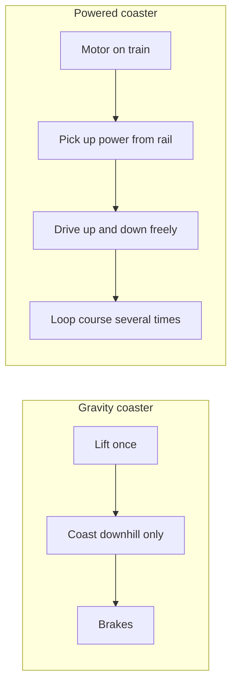

A powered coaster cheats the usual rule. Instead of storing energy at one lift and spending it, the train carries electric motors that drive tyres against a centre rail, taking power from contacts along the track, so it can climb and dive wherever the layout wants and even lap the course several times per cycle. It is closer to an electric train than to a gravity ride, which is why it sits apart from the [energy conversion](../ride-engineering/energy-conversion.md) logic of other coasters.

The format suits theming. Because no tall lift is needed, a powered coaster can wind through rockwork, caves and show scenes with the lighting and animation of a dark ride ([kinetics in scenes](../story-experience/kinetics-in-scenes.md), [environmental storytelling](../story-experience/environmental-storytelling.md)), and it fits under the low ceilings of [indoor parks](../masterplanning/indoor-parks.md). Mack, Zamperla and Wisdom are the main builders; Zamperla's small model needs just 10 kW and reaches 29 km/h.

**Mine train** coasters are the gravity cousins of the same idea. Arrow's Run-A-Way Mine Train at Six Flags Over Texas (1966), an early [Arrow Dynamics](../history/arrow-dynamics.md) hit, used several short lifts, banked turns and low drops to snake through a themed landscape, a recipe copied from Big Thunder Mountain to Expedition Everest.

## Explore further
- `wikipedia-powered-roller-coaster` — Powered roller coaster (Wikipedia)
- `zamperla-powered-coaster` — Zamperla Powered Coaster
- `wikipedia-mine-train-roller-coaster` — Mine train roller coaster (Wikipedia)
