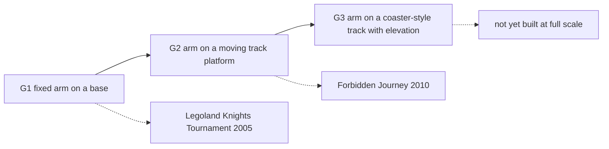

A robot-arm ride takes a factory robot and bolts a passenger seat to its wrist. The arm has six joints, so it can lift, swing, tilt and roll the seat through any pose inside its reach. Gino De-Gol conceived the idea in 2000; his company RoboCoaster and KUKA patented it in 2001 (US 6,776,722) and the first G1 arms opened at Legoland parks in 2004 and 2005, where riders choose their own intensity on a touchscreen, true [agency over spectacle](../human-factors/agency-vs-spectacle.md).

The G2 generation puts the arm on a vehicle that travels a track. Universal's Harry Potter and the Forbidden Journey (2010) uses KUKA KR500 arms on a powered track: each "enchanted bench" swoops through physical sets, then is dipped into curved projection domes that spin on turntables so the screen stays in front of the riders ([domes and wraparound screens](../show-technology/domes-and-wraparound-screens.md)). The seat is held high and the arm is hidden, so riders never see the machine.

Because the arm can apply large forces in any direction, [head and neck loads](../ride-engineering/head-and-neck-loads.md) are programmed and checked, and the robots are certified for passengers under [EN 13814](../safety-standards/en-13814.md). See [Forbidden Journey](../history/forbidden-journey.md) for how [Universal Creative](../history/universal-creative.md) used it.

## Explore further
- `wikipedia-robocoaster` — RoboCoaster (Wikipedia)
- `google-patents-us-6776722` — US 6,776,722 Ride apparatus
- `coaster101-robocoasters-101` — Robocoasters 101 (Coaster101)
- `wikipedia-forbidden-journey` — Harry Potter and the Forbidden Journey (Wikipedia)
