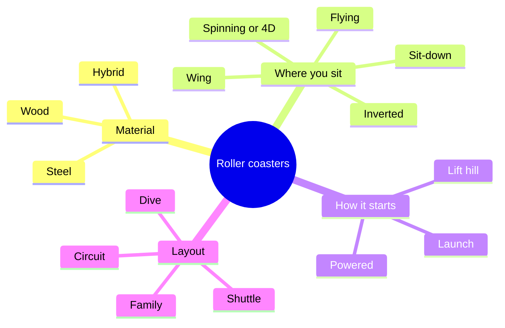

A roller coaster is a train that gains energy once, usually from a lift hill or a launch, then spends it on hills, turns and inversions until the brakes take it back. That single idea, stored energy turned into motion ([energy conversion](../ride-engineering/energy-conversion.md)), is why coasters are sorted in four separate ways rather than one.

The first axis is **material**: wood, steel or a hybrid of the two. The second is **where the rider sits** relative to the rails: on top, hanging underneath, out to the side, or lying face down. The third is **how the train gets its energy**: a chain or cable lift, a launch, or onboard motors. The fourth is **layout**: a full circuit, a shuttle that reverses, a vertical dive, or a gentle family loop.

Steel tube track, introduced on [Matterhorn Bobsleds](../history/matterhorn-bobsleds.md) in 1959, made most of these variations possible. Whatever the type, every coaster is governed by the same physics of [g-force](../ride-engineering/g-force-basics.md) and the same safety logic of the [block system](../ride-engineering/block-system.md). Use the cards below to go one branch at a time.

## Explore further
- `wikipedia-roller-coaster-safety` — Roller coaster (Wikipedia)
- `rcdb-home` — Roller Coaster DataBase
- `wikipedia-steel-roller-coaster` — Steel roller coaster (Wikipedia)
