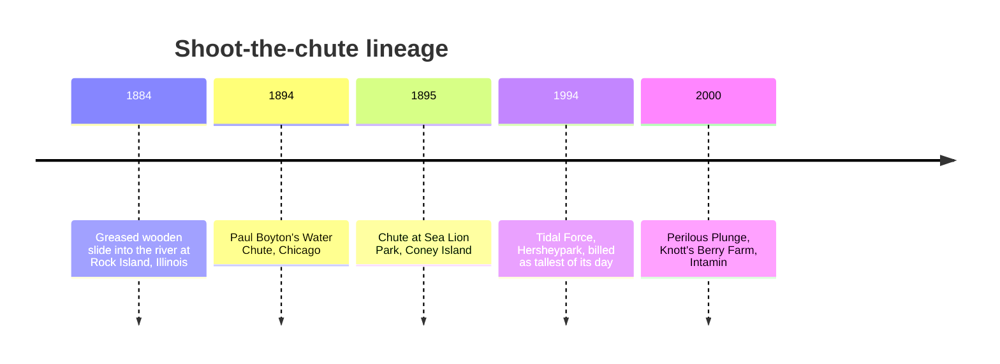

A shoot-the-chute is the simplest water ride and the most spectacular. A big flat-bottomed boat is hauled up a tall lift, turned, and released down a straight ramp into a lagoon. Hitting the water at speed, the boat throws a wave that can swamp a bridge full of spectators, who are often the main audience; the ride sells as many dry views as wet seats, and sits well as a [central icon](../masterplanning/central-icon.md) at the heart of a land.

The form is older than the roller coaster boom. A greased slide at Rock Island, Illinois, opened in 1884, and showman Paul Boyton built chutes in Chicago in 1894 and at Sea Lion Park on [Coney Island](../history/coney-island.md) in 1895, one of the first rides of the enclosed amusement park era ([pleasure gardens and world's fairs](../history/pleasure-gardens-and-worlds-fairs.md)). Hopkins' Tidal Force at Hersheypark (1994) and Intamin's "Giant Splash" family revived the idea at 20 to 35 metres.

The engineering is [water-ride hydraulics](../ride-engineering/water-ride-hydraulics.md) at its most brutal: a 20-seat boat landing flat displaces tonnes of water, and the lagoon, the brake pool and the splash deflectors are sized to that impact. Scheduled drops gather crowds like a show ([parade and show crowds](../masterplanning/parade-and-show-crowds.md)).

## Explore further
- `wikipedia-shoot-the-chute` — Shoot the Chute (Wikipedia)
- `intamin-roller-coasters` — Intamin product range
- `wikipedia-log-flume` — Log flume ride (Wikipedia)
