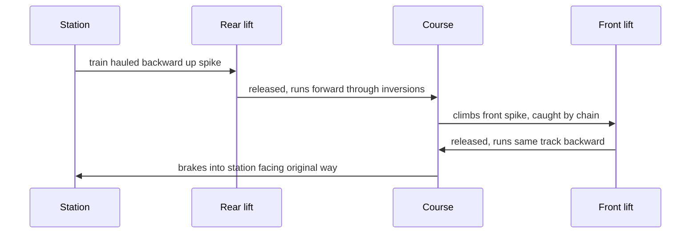

A shuttle coaster never completes a circuit. It runs out, stalls on a spike or a lift, and comes back the way it went, so riders get every element twice, once facing forward and once facing backward. The first American coaster, the 1884 Switchback Railway at Coney Island, was a shuttle ([early coasters](../history/early-coasters.md)), and the format keeps returning because it does so much with so little land.

Vekoma's **Boomerang** (1984) is the best-known model, with dozens built from the same drawings: a chain hauls the train backward up a spike, drops it through a cobra roll and a loop, a second lift catches it, and the whole thing repeats in reverse. The family-scale version gives children their first backward ride. Schwarzkopf's Shuttle Loop and Intamin's Impulse coasters replaced the [lift](../ride-engineering/lift-systems.md) with a launch, and Vekoma's Super Boomerang (2023) adds a vertical lift and rotating platform.

The format's limits are the trade-off. Two lifts and a single train give modest throughput, which planners must weigh in [capacity planning](../masterplanning/capacity-planning.md), and the climb up the spike is a long moment of [anticipation](../human-factors/anticipation-and-dread.md). Modern [multi-launch coasters](../ride-systems/multi-launch-coasters.md) keep the backward thrills but with higher capacity.

## Explore further
- `wikipedia-shuttle-roller-coaster` — Shuttle roller coaster (Wikipedia)
- `vekoma-family-boomerang` — Vekoma Family Boomerang
- `wikipedia-shuttle-loop` — Shuttle Loop (Wikipedia)
