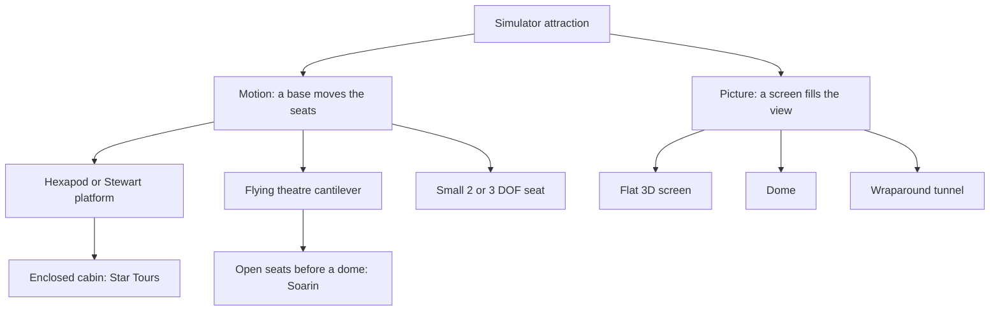

A simulator attraction is a machine for lying to the inner ear. A screen fills your vision with movement, a seat tilts and jolts in time with it, and your brain, taking the sum of eye and [vestibular system](../human-factors/vestibular-system.md), concludes you are flying, falling or racing while in fact you have travelled a metre or two. When the lie is good the effect is [presence](../human-factors/presence.md); when picture and motion disagree, [sensory conflict](../human-factors/sensory-conflict-theory.md) produces [motion sickness](../human-factors/motion-sickness.md).

The family has two halves. The **motion** side runs from six-legged hexapod platforms, borrowed from flight simulators, to small seat actuators and the cantilever arms of flying theatres. The **picture** side runs from flat 3D screens to domes and wraparound tunnels ([projection and screens](../show-technology/projection-and-screens.md)). Disney's Star Tours (1987) put forty riders in an enclosed hexapod cabin; Soarin' (2001) hung riders in front of a dome. Both have spawned catalogue products from Brogent, Simworx, Dynamic and others.

The craft that makes all of it work is motion cueing: deciding which accelerations to fake, and how to drift the seat back to centre without anyone noticing. The cards below walk through the hardware, the theatre formats and the hybrids that bolt simulators into dark rides and coasters.

## Explore further
- `wikipedia-motion-simulator` — Motion simulator (Wikipedia)
- `wikipedia-flying-theater` — Flying theater (Wikipedia)
- `wikipedia-star-tours` — Star Tours (Wikipedia)
