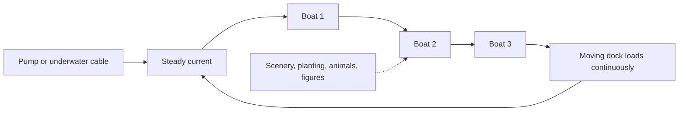

A slow boat ride is a cruise. Big open boats of eight to twenty riders drift along a winding channel outdoors, pushed by a gentle current or towed by a cable under the water, past landscape, animal enclosures, waterfalls and the occasional animatronic. There is no drop and no splash by design; the ride exists to let people sit down, cool off and look at something for ten minutes, which is why planners count it as a [rest area](../masterplanning/rest-areas.md) that happens to have capacity.

Disney's Jungle Cruise (1955) is the archetype, with a skipper's script turning the scenery into comedy; Efteling's Fata Morgana and Singapore's River Safari boats are Intamin installations from the same catalogue model, which offers bench or individual seats, stop-and-go or continuous loading, and indoor, outdoor or mixed routes. The low floor and wide boat make this one of the easiest rides to board from a wheelchair ([accessible vehicles](../human-factors/accessible-vehicles.md)).

Because boats never stop and carry many people, [throughput](../operations-business/throughput-math.md) is excellent. The design effort goes into what is on the banks: this is [environmental storytelling](../story-experience/environmental-storytelling.md) and [planting design](../sensory-environment/planting-design.md) seen from water level at walking pace. Take the same boat indoors and you have a [boat dark ride](../ride-systems/boat-dark-ride.md).

## Explore further
- `intamin-slow-boat-ride` — Intamin Slow Boat Ride
- `wikipedia-dark-ride` — Dark ride (Wikipedia)
- `wikipedia-pirates-of-the-caribbean-attraction` — Pirates of the Caribbean attraction (Wikipedia)
