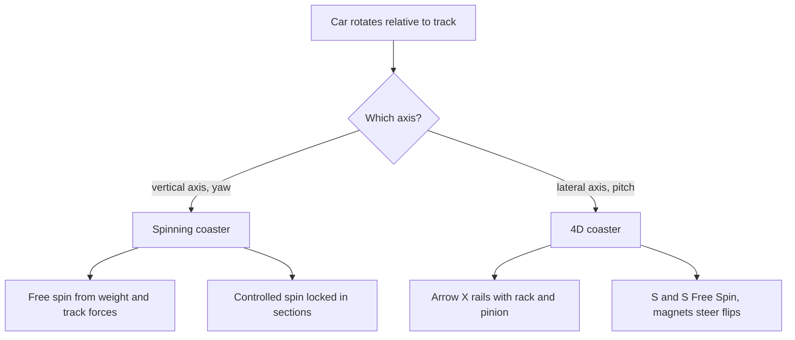

A spinning coaster adds a rotation the track did not ask for. In the classic form the car sits on a turntable and **yaws**, turning left and right as the layout's curves and the riders' weight shove it around. The result is a ride that is different every time: a heavy pair on one side, a sharp turn, and the car whips backward into the next drop. The idea dates to the 1908 Virginia Reel at Coney Island; Maurer, Gerstlauer and Mack's Xtreme Spinning Coaster (Time Traveler, 2018) are modern versions, usually with brakes that lock the spin in some sections.

**4D coasters** rotate on the other axis: seats pitch head-over-heels while the track stays flat. Arrow's X at Six Flags Magic Mountain (2002) used two extra rails and a rack-and-pinion to script every flip, a last feat from [Arrow Dynamics](../history/arrow-dynamics.md). S&S's Free Spin and Intamin's ZacSpin let seats tumble freely, with magnets nudging flips in chosen places.

Both styles trade on [surprise](../human-factors/surprise-and-delight.md) and on the [vestibular system](../human-factors/vestibular-system.md): unexpected rotation stirs the [semicircular canals](../human-factors/semicircular-canals.md), which is thrilling for some riders and a straight route to [motion sickness](../human-factors/motion-sickness.md) for others.

## Explore further
- `wikipedia-spinning-roller-coaster` — Spinning roller coaster (Wikipedia)
- `wikipedia-4th-dimension-roller-coaster` — Fourth-dimension roller coaster (Wikipedia)
- `s-s-4d-free-spin-coaster` — S&S 4D Free Spin Coaster
