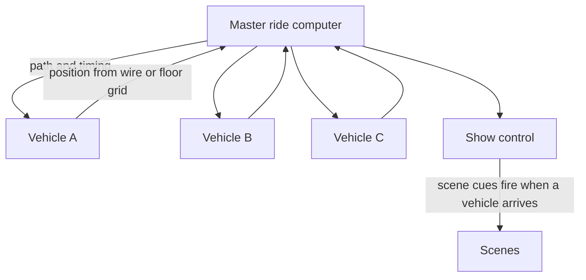

A trackless ride vehicle is a battery-powered robot cart with no rail. It knows where it is by reading a guide wire buried in the floor or a grid of markers under the tiles, and a central computer tells every vehicle where to go next. Freed from a track, vehicles can spin in place, reverse, drift sideways, split onto different routes and dance around each other in one room, then regroup. Every rider can get a different path, which is the technical root of [personalised dark rides](../ai-future/personalized-dark-rides.md).

Disney's Pooh's Hunny Hunt at Tokyo Disneyland (2000) was the first full attraction built this way, with honey pots choreographed to music. [Mystic Manor](../history/mystic-manor.md) (2013) and [Rise of the Resistance](../history/rise-of-the-resistance.md) (2019) built on it. Off the shelf, ETF Ride Systems' Mystic Mover follows an invisible wire at 0.8 m/s on a 14-hour battery, and Falcon's Revolution, formerly Oceaneering's, adds a motion base.

The price is control. With no block brakes, vehicle spacing lives entirely in software, so the [ride control system](../safety-standards/ride-control-systems.md) must treat each cart as an independent robot ([free-roaming robots](../ai-future/free-roaming-robots.md)). The payoff is [surprise](../human-factors/surprise-and-delight.md): a car that suddenly flees, or returns to a scene it just left.

## Explore further
- `wikipedia-pooh-hunny-hunt` — Pooh's Hunny Hunt (Wikipedia)
- `etf-mystic-mover` — ETF Ride Systems Mystic Mover
- `blooloop-oceaneering-revolution-2013` — Oceaneering REVOLUTION trackless system (Blooloop)
- `falcons-oes-ride-systems` — Falcon's OES Ride Systems
