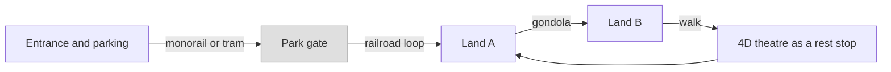

Not every ride exists to thrill. A large park is a small city, and some of its vehicles are there to move people from the car park to the gate, from one land to the next, or simply to give tired feet a loop around the site ([guest flow patterns](../masterplanning/guest-flow-patterns.md), [parking and transit](../masterplanning/parking-and-transit.md)). Walt Disney's railroad and monorail were transport first and attraction second, and the habit of theming transit so well that guests queue for it is now a Disney and Universal signature ([resort integration](../masterplanning/resort-integration.md)).

This group collects those systems: **monorails and people movers**, **park trains**, and **gondolas and skyrides**. Each doubles as a scenic ride and as a planning tool, since a transport loop sets where guests enter a land and how a [land transition](../masterplanning/land-transitions.md) is experienced from above or from a window.

Two other cards live here because they fit nowhere else. **4D theatres and walkthroughs** are seated or walking shows with physical effects, the cheapest high-capacity attraction a park can build. **Ride classification** explains how parks, manufacturers and databases sort everything in this land into types and thrill levels, which drives [capacity planning](../masterplanning/capacity-planning.md), signage and guest expectations.

## Explore further
- `wikipedia-monorail` — Monorail (Wikipedia)
- `wikipedia-disneyland-railroad` — Disneyland Railroad (Wikipedia)
- `wikipedia-skyway-disney` — Skyway (Disney) (Wikipedia)
