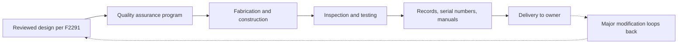

A drawing is only a promise. ASTM F1193, Standard Practice for Quality, Manufacture, and Construction of Amusement Rides and Devices, sets the minimum requirements for a manufacturer's quality assurance program and for how the ride, or a major modification, is actually built. It has existed since 1997 and is revised regularly.

In plain terms the practice asks: does the factory have a written system that guarantees the steel, welds, bolts, hydraulics and controls match the reviewed design, and can it prove it later? That means qualified processes, inspection of materials and workmanship, traceable records, and the documentation that travels with the ride, including the manual the owner will run it from. It is the bridge between [F2291](../safety-standards/astm-f2291.md) design and [F770](../safety-standards/astm-f770.md) operation.

The payoff appears years later. [Fatigue](../ride-engineering/fatigue.md) cracks and hidden [corrosion](../ride-engineering/corrosion-and-weathering.md) are far easier to anticipate when [coaster manufacturers](../history/coaster-manufacturers.md) have documented what was built and how. For a design team, a clean F1193 record is what makes the [engineering handoff](../design-process/engineering-handoff.md) real, and it is what later [fabrication](../design-process/fabrication.md) of themed elements must not compromise.

## Explore further
- `astm-f1193-manufacturing` — ASTM F1193 Quality, Manufacture, and Construction of Amusement Rides
- `astm-f24-committee` — ASTM Committee F24 on Amusement Rides and Devices
