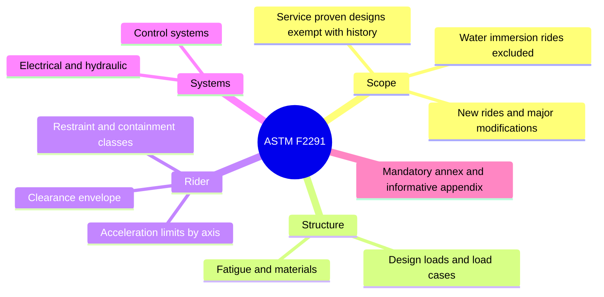

ASTM F2291, Standard Practice for Design of Amusement Rides and Devices, is the document a ride engineer lives in. It applies to rides, devices and major modifications built after its publication date. It does not cover patron-directed devices such as go-karts, climbing walls, air-supported structures, dry slides, coin-operated rides or water rides with deliberate immersion, which have their own standards. A pre-existing design can be exempt if the manufacturer documents that it is "service proven".

Inside, the practice sets out design loads, [fatigue](../ride-engineering/fatigue.md) analysis, materials, and the combined acceleration limits that define a ride's [acceleration envelope](../ride-engineering/acceleration-envelopes.md), supported by F2137 for measuring them. It also governs [restraint mechanisms](../ride-engineering/restraint-mechanisms.md), the patron clearance or [reach envelope](../safety-standards/reach-envelope.md), electrical, hydraulic and control systems, and the ride analysis that ties them together. The annex is mandatory; the appendix is explanatory. Units are inch-pound with SI in parentheses. Revisions are frequent, often more than once a year, so [ride layout design](../design-process/ride-layout-design.md) should cite the exact edition it was checked against.

## Explore further
- `astm-f2291-design` — ASTM F2291 Standard Practice for Design of Amusement Rides and Devices
- `astm-f2137-dynamics` — ASTM F2137 Measuring the Dynamic Characteristics of Amusement Rides
