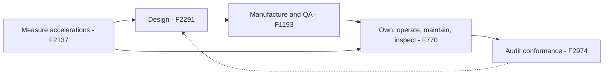

ASTM International's Committee F24 on Amusement Rides and Devices was formed in 1978. It now has around a thousand members and jurisdiction over roughly 29 standards, published in the Annual Book of ASTM Standards, Volume 15.07. Members meet twice a year, usually February and October, and ballot every change; manufacturers, parks, inspectors, regulators and consultants all vote.

The standards are organised around a ride's life. [F2291](../safety-standards/astm-f2291.md) sets design criteria. [F1193](../safety-standards/astm-f1193.md) covers quality and manufacturing. [F770](../safety-standards/astm-f770.md) tells the owner how to operate, maintain and inspect. [F2974](../safety-standards/astm-f2974.md) explains how to audit all of the above. Supporting practices such as F2137 define how to measure the accelerations that feed the [acceleration envelopes](../ride-engineering/acceleration-envelopes.md).

F24 standards are voluntary until a state or country adopts them, which many do by reference. For a designer, the [engineering handoff](../design-process/engineering-handoff.md) package to a manufacturer is effectively an F2291 compliance file, and the park's [preventive maintenance](../operations-business/preventive-maintenance.md) plan should trace back to F770.

## Explore further
- `astm-f24-committee` — ASTM Committee F24 on Amusement Rides and Devices
- `astm-f2137-dynamics` — ASTM F2137 Measuring the Dynamic Characteristics of Amusement Rides
