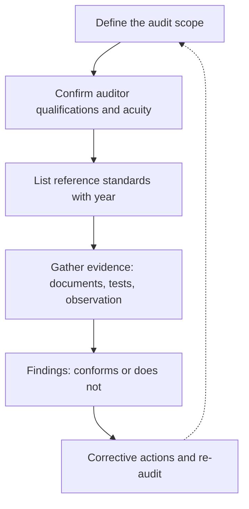

Who checks the checkers? ASTM F2974, Standard Practice for Auditing Amusement Rides and Devices, sets the minimum requirements for auditing a ride's conformance to the F24 standards within a defined scope. First published in 2013, its current edition is 2024.

The practice is mostly about discipline. The audit must state its scope, including which standards and which published year are being audited against, because [F2291](../safety-standards/astm-f2291.md) changes often. The auditor must have the education, training, certifications and experience relevant to that scope, and even visual acuity requirements where they matter. Only then do the usual steps follow: review documents, witness tests, observe operations, record findings.

An audit is not the same as a daily or annual [inspection](../safety-standards/inspections.md). Inspection asks "is this ride in good condition today?"; an audit asks "does the whole system, from design file to training records, conform to the standard?". Parks use F2974 at [testing and commissioning](../design-process/testing-and-commissioning.md), after major modifications, and as part of the [design review gates](../design-process/design-reviews-and-gates.md) that larger operators require. Auditors are often certified through [professional bodies](../careers/professional-bodies.md) such as AIMS International or NAARSO.

## Explore further
- `astm-f2974-auditing` — ASTM F2974 Standard Practice for Auditing Amusement Rides and Devices
- `astm-f24-committee` — ASTM Committee F24 on Amusement Rides and Devices
