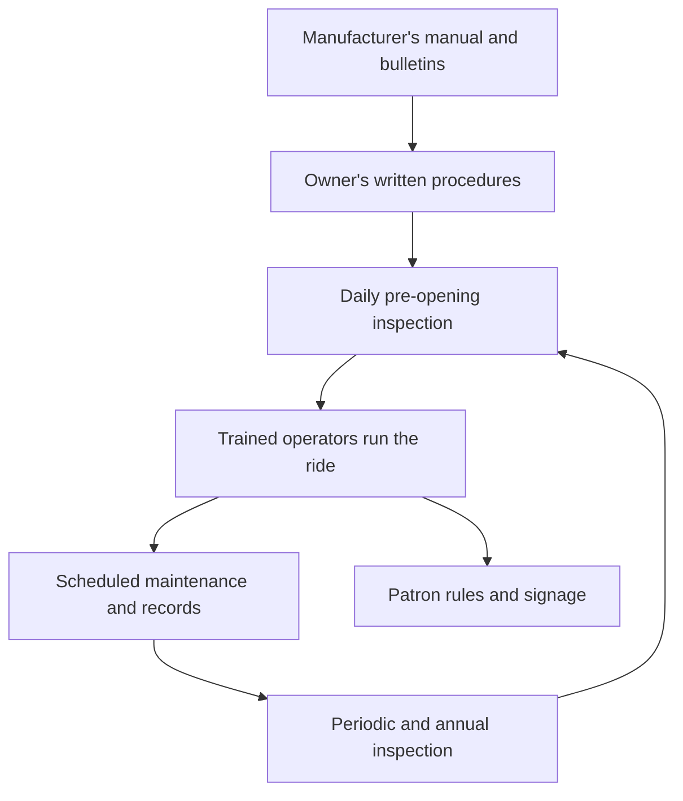

Design standards stop at the factory gate. ASTM F770, the Standard Practice for Ownership, Operation, Maintenance, and Inspection of Amusement Rides and Devices, picks up from there. It gives the owner and operator guidelines for the procedures they must write and follow: how the ride is inspected before opening, how operators are trained, how maintenance is scheduled and recorded, and how the manufacturer's manual and service bulletins are folded into daily life. The practice has been revised steadily since the early 1990s and is on its 2026 edition.

The spirit is simple. A safe ride is not only a well-built machine but a well-run one. That is why F770 sits behind a park's [preventive maintenance](../operations-business/preventive-maintenance.md) plan, its [opening and closing procedures](../operations-business/opening-and-closing-procedures.md) and its [ride operations staffing](../operations-business/ride-operations-staffing.md). It also covers the patron side: what riders must be told and what they are expected to do, which underpins [rider compliance](../human-factors/rider-compliance.md). The daily walk-down described in Coaster101's inspection primer is the F770 cycle made visible.

## Explore further
- `astm-f770-operations` — ASTM F770 Ownership, Operation, Maintenance, and Inspection of Amusement Rides
- `coaster101-inspection-101` — Coaster101: Roller Coaster Inspection 101
