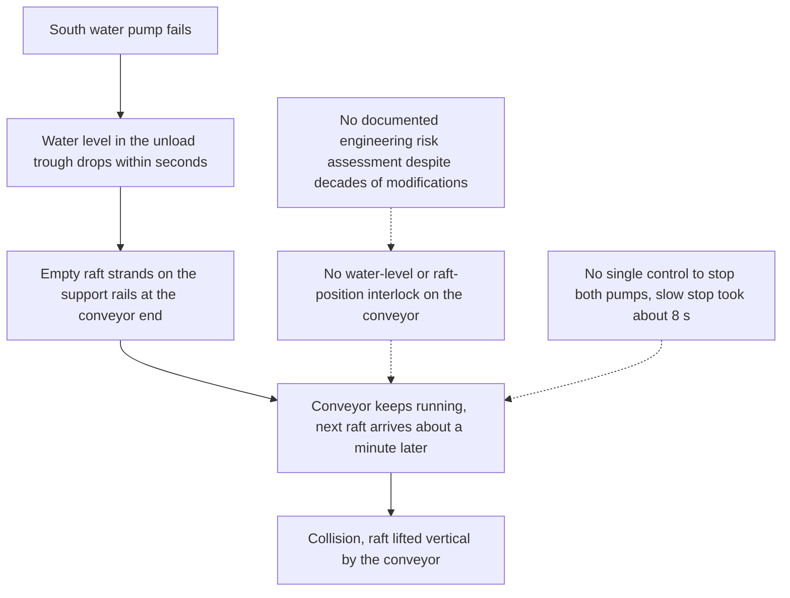

Dreamworld's Thunder River Rapids ride opened in the 1980s and was modified many times over thirty years. On 25 October 2016 one of its two large water pumps failed. The water level at the unload end fell fast, an empty raft settled onto the steel support rails near the top of the conveyor, and the conveyor kept moving. About a minute later a raft carrying six people was driven into it and tipped vertically. Four people died.

The coroner's 2020 findings list several oversights. There was no interlock that stopped the conveyor when the water level or a raft position was wrong. There was no single emergency control that stopped both pumps, and the conveyor stop button at the main panel took about eight seconds to halt the belt while the emergency stop took two. A documented engineering risk assessment of the whole ride had never been conducted.

Every modification, including a [retheme or overlay](../operations-business/retheming-and-overlays.md), re-opens the [risk assessment](../safety-standards/risk-assessment.md). Water rides need [hydraulics](../ride-engineering/water-ride-hydraulics.md) treated as a safety system, with level sensing wired to the conveyor on a [river rapids](../ride-systems/river-rapids.md) ride. [Emergency stop](../safety-standards/emergency-stop-and-evacuation.md) placement and speed are design decisions. [Design review gates](../design-process/design-reviews-and-gates.md) exist so someone asks the obvious question first.

## Explore further
- `qld-coroner-dreamworld-2020` — Coroners Court of Queensland: Findings of the Dreamworld inquest
- `wikipedia-thunder-river-rapids` — Wikipedia: Thunder River Rapids Ride
- `iso-12100-risk-assessment` — ISO 12100:2010 Safety of machinery, risk assessment and risk reduction
