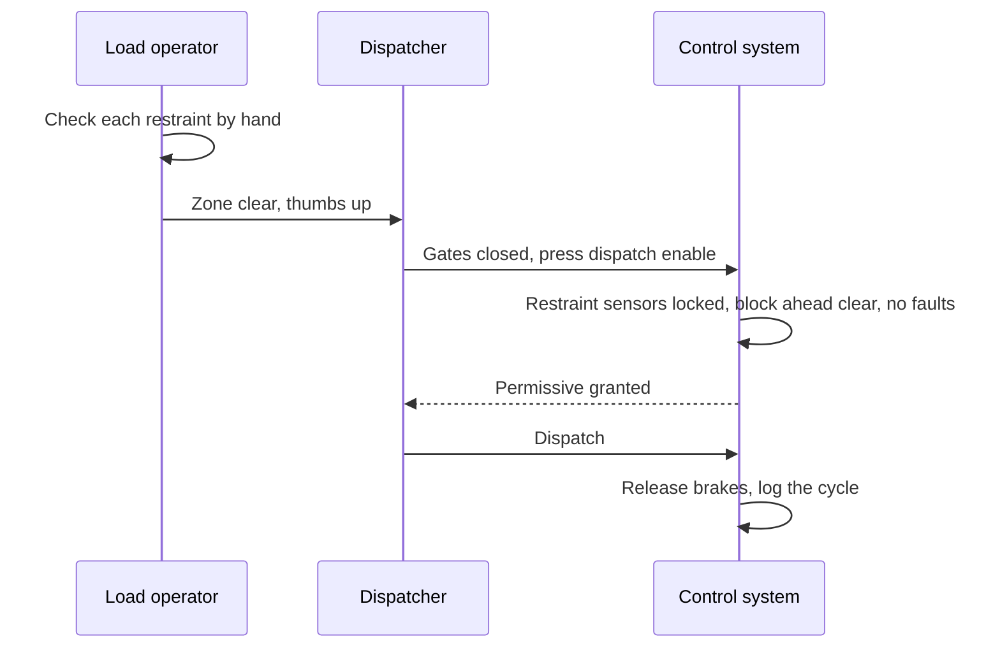

Dispatch is the moment a ride commits. A typical coaster station runs like this: loaders check each restraint by hand and confirm riders meet the rules, the platform and gates are confirmed clear, operators signal readiness, often with a visible thumbs up, and the dispatcher presses an enable that only works when the [ride control system](../safety-standards/ride-control-systems.md) agrees: restraint sensors locked, gates closed, the block ahead empty, no active faults. Many rides require two separate enable actions from two people so that one distracted person cannot send a train.

It is where [load and unload design](../operations-business/load-unload-design.md) meets human behaviour, and it sets the practical [dispatch interval](../operations-business/dispatch-interval.md) that [throughput math](../operations-business/throughput-math.md) depends on. Designers who want the station to feel like part of the story, the idea behind [load as story](../story-experience/load-as-story.md), must do it without adding steps that tempt operators to skip.

The 2004 Big Thunder Mountain collision at Disneyland, in which a train entering the station hit a parked train, was attributed by California's investigators to an operator switching the station into a storage mode out of sequence, combined with a control system that did not prevent the error. Procedures and interlocks have to cover each other.

## Explore further
- `astm-f770-operations` — ASTM F770 Ownership, Operation, Maintenance, and Inspection of Amusement Rides
- `coaster101-brakes-blocks-sensors` — Coaster101: Brakes, blocks and sensors
- `tpi-big-thunder-2004-dosh` — Theme Park Insider: State blames cast member, ride system for Big Thunder Mountain accident
