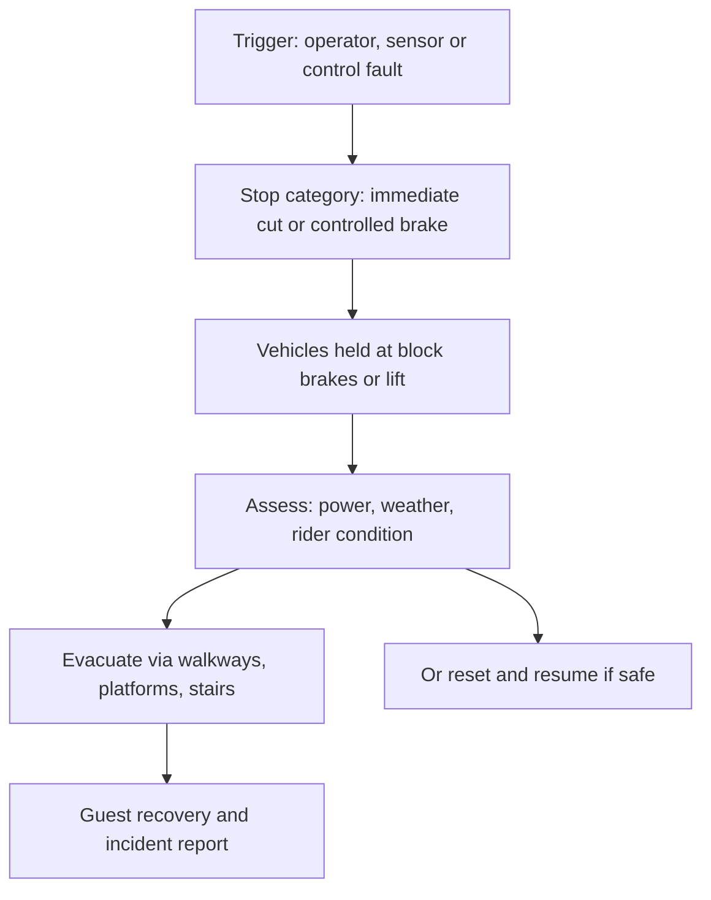

ISO 13850 sets the basics for machinery: a red mushroom-head control on a yellow background, reachable without hesitation, that latches until deliberately reset, with a defined stop category, either cutting power immediately or braking under control and then cutting power. On a ride the controller then holds every vehicle at the nearest [block](../ride-engineering/block-system.md) brake, launch position or lift, and that geometry decides the rest.

Evacuation design asks: from every place a vehicle can stop, how do riders get out? That means walkways or stairs beside lifts and [lift systems](../ride-engineering/lift-systems.md), platforms at block brakes, restraint releases that work without power, and routes that connect to the park's [emergency access](../masterplanning/emergency-access.md) roads.

The Dreamworld inquest shows the stakes. On the Thunder River Rapids ride the only stop control an operator could reach at the unload point was an emergency stop; investigators found it halted the conveyor in about two seconds, while the conveyor stop button at the main panel took around eight, and there was no single control that stopped both water pumps. Those seconds and that layout are part of why it is a [design oversight case](../safety-standards/design-oversight-cases.md). Afterwards comes the human side, handled by [guest recovery](../operations-business/guest-recovery.md).

## Explore further
- `iso-13850-emergency-stop` — ISO 13850:2015 Emergency stop function, principles for design
- `qld-coroner-dreamworld-2020` — Coroners Court of Queensland: Findings of the Dreamworld inquest
- `coaster101-brakes-blocks-sensors` — Coaster101: Brakes, blocks and sensors
