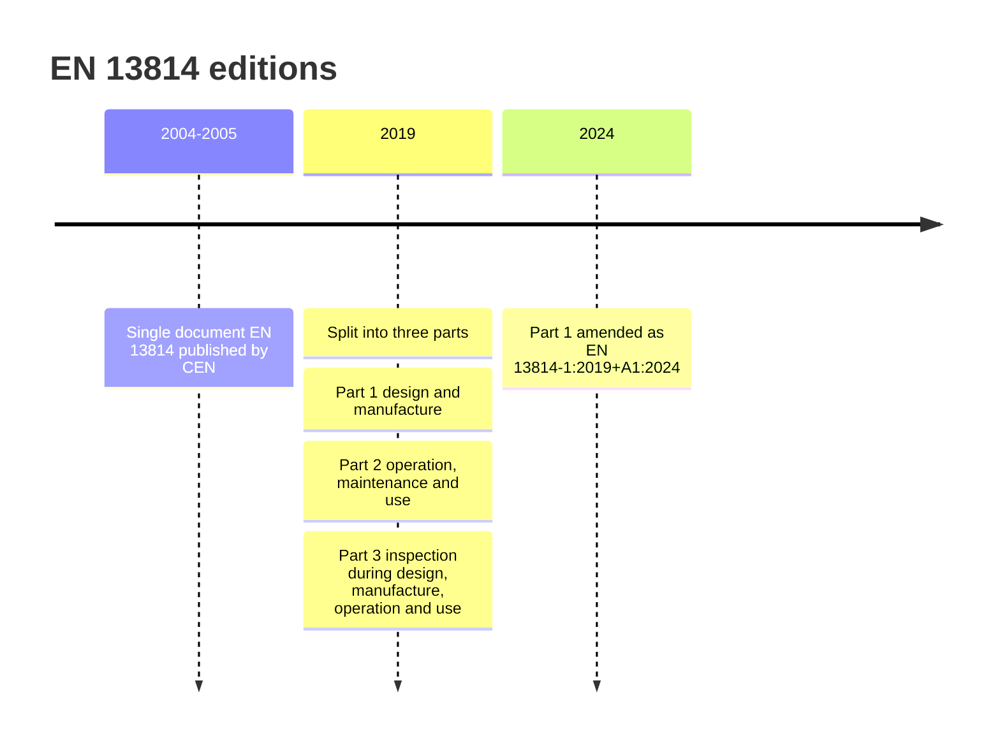

EN 13814 is the European answer to the question "what does a safe ride look like?". It was written by CEN Technical Committee 152, "Fairground and amusement park machinery and structures - Safety", and first published as one document in the mid-2000s. In 2019 it was split into three parts: Part 1 for design, calculation, manufacture and installation; Part 2 for operation, maintenance and use; and Part 3 for the inspections that run through all of those stages. Part 1 was amended in 2024.

The scope covers mobile, temporary and permanent machinery built for leisure: roundabouts, Ferris wheels, roller coasters, swings. Grandstands, scaffolding, playground equipment, trampolines and small coin-operated kiddie rides fall under other norms. Because it grew out of the German travelling-fair tradition, with certification bodies such as TÜV SÜD testing rides at the Oktoberfest since 1929, it is strong on structural calculation, [restraint locking](../ride-engineering/restraint-locking.md) and third-party examination.

For [European parks](../history/european-parks.md) and [coaster manufacturers](../history/coaster-manufacturers.md) it is the baseline, and inspectors expect [testing and commissioning](../design-process/testing-and-commissioning.md) evidence against it. It is closely aligned with [ISO 17842](../safety-standards/iso-17842.md) and overlaps in intent with [ASTM F24](../safety-standards/astm-f24.md).

## Explore further
- `genorma-en-13814-1` — EN 13814-1:2019+A1:2024 Safety of amusement rides, Part 1
- `sis-en-13814-2005` — SS-EN 13814:2005 catalogue entry (original single-part edition)
- `tuv-sud-kasper-2011-ride-certification` — TÜV SÜD: Ride certification scheme and operation authorization (talk)
